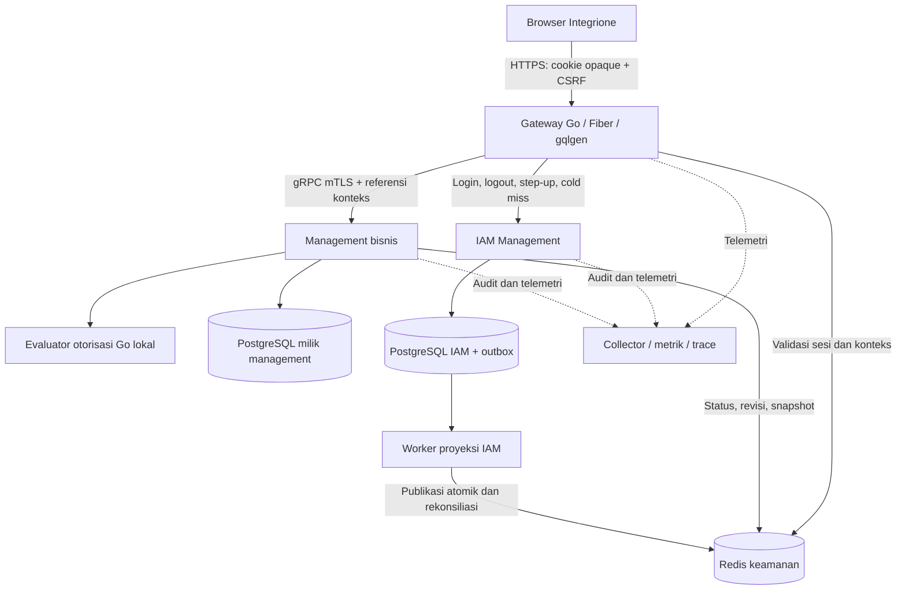

# Arsitektur Sistem Integrione: Sesi Backend dan Otorisasi RBAC–ABAC

Tanggal baseline kebijakan: **11 November 2026**. Revisi: **12 November 2026**. Status: **keputusan D01–D12 disetujui owner; sebagian kontrak/runtime IAM sudah diimplementasikan, tetapi cutover sesi browser, otorisasi seluruh management, dan failover Redis yang teruji masih memerlukan pekerjaan**.

Dokumen ini menjawab kebutuhan autentikasi dan otorisasi lintas management tanpa membawa ribuan izin di browser dan tanpa memanggil IAM/PostgreSQL untuk setiap pemeriksaan akses pada jalur normal. Cakupannya adalah arsitektur ERP di sekitar identitas, sesi, policy, data bisnis, dan operasi pendukungnya. Pemilihan framework frontend, integrasi eksternal, dan rancangan lengkap setiap domain bisnis berada di luar dokumen ini.

Owner menetapkan keputusan revoke A, transaksi sensitif B, dan gangguan IAM A, kemudian menyetujui seluruh rekomendasi leader untuk pertanyaan lainnya. Keputusan lengkap ada pada bagian 21 dan berlaku sebagai acuan desain. Tugas saat ini memperbarui dokumentasi; tidak mengubah runtime, dependency, skema, deployment, atau kontrak aktif. Implementasi berikutnya mengikuti [AGENTS.md](../AGENTS.md), [boundary management](boundary.md), dan cakupan pekerjaan yang ditugaskan. Git tag/release tetap pencatatan progres; production/customer release memerlukan instruksi owner tersendiri.


### Panduan membaca: keputusan, kondisi historis, dan status runtime

**Keputusan owner** D01–D12 pada bagian 21 bersifat normatif, sedangkan bagian 2, 5, 17 dan 22 merekam audit historis 11 November 2026. Kode dan verifikasi terus berubah; status berikut diperiksa pada repository 12 November 2026. Dokumen yang disetujui bukan bukti bahwa endpoint atau deployment sudah memenuhi semua keputusan.

| Area | Fakta pada source sekarang | Batas klaim |
|---|---|---|
| IAM | Kontrak browser opaque, sesi, CSRF, snapshot akses dan evaluator Go bersama sudah ada. | Kontrak dan implementasi komponen bukan bukti cutover browser/Gateway atau penerapan guard seluruh management selesai. |
| Gateway | Middleware autentikasi/CSRF serta pemeriksaan operasi GraphQL tersedia. | Cookie lama masih perlu transisi yang diuji, termasuk guest dan publik. |
| Redis | Dependency development tersedia dan IAM memiliki alur runtime/revisi. | Failover lintas instance dengan recovery gate wajib dibuktikan sebelum aktivasi HA. |
| Finance AP | Service Accounts Payable tersedia dan dipilih sebagai pilot setelah readiness IAM–Gateway. | Pilot seluruh operasi, SoD, scope dan recheck belum boleh diklaim sebelum E2E nyata. |
| Commerce | Skema database dan GraphQL toko web perusahaan telah didefinisikan. | Implementasi gRPC/Go/resolver bisnis lengkap masih pekerjaan tersendiri. |

**Referensi aktual:** [konteks IAM](context/iam_management/1-context.md) · [browser proto](../backend/contracts/proto/iam_management/authentication/v1/browser_session.proto) · [access snapshot proto](../backend/contracts/proto/iam_management/policy/v1/access_snapshot.proto) · [evaluator](../backend/shared/authz/evaluator.go) · [Gateway auth](../backend/gateway/internal/middleware/auth.go) · [Gateway CSRF](../backend/gateway/internal/middleware/csrf.go) · [status IAM](../docs/00-governance/status-and-evidence.md) · [Commerce](../backend/services/ecommerce_commerce/README.md).

Jika ada perbedaan antara dokumentasi lama, kode aktif dan keputusan owner: **jangan mengubah kebijakan diam-diam**. Verifikasi bukti source terbaru, catat perbedaan, dan ajukan keputusan ke leader/owner. Instruksi ini tidak memberi izin lintas management, tidak mengaktifkan konfigurasi production, dan tidak membuat role/permission sebagai seed otomatis.

## 1. Ringkasan keputusan arsitektur

Gunakan **cookie opaque + sesi server-side + Redis bersama + snapshot akses berversi + evaluasi permission/scope/ABAC di service pemilik objek**. IAM tetap sumber kebenaran identitas dan akses. PostgreSQL menyimpan data otoritatif; Redis menyediakan proyeksi keamanan untuk jalur request. Gateway menangani browser dan membawa referensi konteks yang terverifikasi ke management melalui gRPC terautentikasi.

JWT browser digantikan ID sesi acak. Data role, permission, dan atribut ABAC tidak dimasukkan seluruhnya ke cookie atau metadata gRPC. Role tetap dipakai untuk administrasi izin, permission menentukan tindakan, dan ABAC membatasi tindakan berdasarkan atribut serta keadaan objek.

Target jalur normal: **tidak ada IAM RPC atau SQL IAM untuk validasi akses ketika sesi dan snapshot masih valid**. Pembacaan Redis tetap ada; query database management untuk objek bisnis tetap ada. Login, perubahan akses, cache miss, refresh otoritatif, dan rekonsiliasi dapat membutuhkan IAM/SQL. Belum ada angka performa yang diukur untuk rancangan ini.

Rekomendasi implementasi pertama mengutamakan pemeriksaan status/revisi pada Redis primary. Cache lokal hanya menyimpan snapshot immutable yang versinya sudah diperiksa, bukan keputusan ALLOW atau status sesi yang boleh tertinggal tanpa batas.

## 2. Kondisi kode historis yang diperiksa pada 11 November 2026

| Area | Fakta saat pemeriksaan | Implikasi |

|---|---|---|

| Gateway | `authenticate` memanggil IAM `GetAuthenticationContext` ketika menerima access token | Jalur autentikasi masih mempunyai round-trip IAM |

| IAM runtime | `GetAuthenticationContext` mengambil state sesi dan `getActor` memuat grant | Penggantian format token saja tidak menghilangkan pembacaan akses |

| SQL state sesi | Memeriksa principal aktif, sesi, kredensial dan expiry | Pemeriksaan ini harus dipertahankan semantiknya saat diproyeksikan |

| JWT claims | Identitas standar, `sid`, `auth_version`, `authorization_version`, `session_exp` | JWT sekarang tidak memuat seluruh daftar role/permission |

| Evaluator IAM | `Require` memeriksa permission, scope, valid-until, DENY/ALLOW | Dapat menjadi titik awal semantik, bukan bukti ABAC lintas management telah selesai |

| Fiber | Awal diskusi `v3.6.1`; diperbarui ke `v3.7.0` atas instruksi owner | Dukungan library tidak berarti sesi Redis sudah dipakai |

| Development Compose | Redis 8.10.3 dan PostgreSQL 18.6 berjalan healthy melalui tag `latest` | Infrastruktur lokal tersedia; integrasi sesi/IAM/CSRF ke Redis belum diimplementasikan |

Bukti source: [middleware Gateway](../backend/gateway/internal/middleware/auth.go), [runtime IAM](../backend/services/iam_management/internal/service/authentication/runtime.go), [state SQL](../backend/services/iam_management/internal/repository/authentication/runtime_state.go), [claims](../backend/shared/authn/claims.go), [evaluator](../backend/services/iam_management/internal/authorization/evaluator.go), [go.mod Gateway](../backend/gateway/go.mod), [go.mod IAM](../backend/services/iam_management/go.mod), [Compose development](../backend/deploy/docker-compose.dev.yml).

Graph backend diperiksa pada generation `2026-11-11T05:20:14Z` untuk empat path utama Gateway/runtime/evaluator/claims, tanpa gap tercatat dan metadata sesuai. Snippet serta trace pada jalur autentikasi telah dibaca. Coverage adalah sinyal best-effort, bukan audit menyeluruh. [Konteks IAM](context/iam_management/1-context.md) masih mencatat interpreter kondisi ABAC belum tersedia; status historis itu harus diverifikasi ulang ketika domain tersebut mulai diimplementasikan.

## 3. Prinsip dan sasaran desain

1. Satu pemilik data dan lifecycle: IAM untuk akses; management untuk objek bisnisnya.

2. Semua operasi terlindungi mengevaluasi izin; cache mempercepat penyediaan data, bukan menghapus pemeriksaan.

3. Tidak ada ALLOW jika sesi, atribut wajib, policy, versi atau dependency keamanan tidak dapat diverifikasi.

4. Permission selalu terikat scope, effect, kondisi dan masa berlaku grant asalnya.

5. Data pengguna dari browser bukan sumber otoritas. Pemilihan perusahaan di UI merupakan permintaan, bukan bukti keanggotaan.

6. Penghapusan izin memiliki status efektivitas yang jelas; commit SQL tidak otomatis berarti seluruh jalur runtime sudah berubah.

7. Proyeksi dapat dibangun ulang dari sumbernya, tetapi sesi hilang tidak otomatis dihidupkan kembali dari catatan historis.

8. Performa, toleransi gangguan, dan jaminan revoke harus diuji; tidak ada klaim zero-I/O, pencabutan instan lintas failover, atau latensi tertentu tanpa bukti.

Pemeriksaan setiap request dan deny-by-default mengikuti [OWASP Authorization](https://cheatsheetseries.owasp.org/cheatsheets/Authorization_Cheat_Sheet.html). Istilah ABAC merujuk evaluasi subject, object, action dan environment terhadap policy menurut [NIST SP 800-162](https://csrc.nist.gov/pubs/sp/800/162/upd2/final).

## 4. Peta sistem dan batas kepercayaan



Browser hanya mengakses Gateway. Redis dan gRPC management tidak menjadi endpoint publik. Gateway dan management memiliki identitas workload sendiri. mTLS membuktikan identitas pemanggil antarlayanan; permission pengguna tetap harus dievaluasi. Lihat kemampuan transport terautentikasi pada [gRPC Authentication](https://grpc.io/docs/guides/auth/).

**Inventaris historis 12 November 2026** pernah mencatat delapan service bisnis termasuk `manufacturing_operations`. Pada tree `main` yang diperiksa 13 November 2026, direktori aktif `backend/services/` memuat **13 management Retail ERP** menurut [peta management](../docs/03-managements/README.md), sedangkan direktori service Manufacturing tidak ada. Bukti kode/tes harus dievaluasi ulang per commit; keberadaan scaffold bukan bukti integrasi aktif.

Setiap management menggunakan database miliknya. Tidak ada SQL/FK lintas database management maupun impor repository internal management lain. Replikasi atribut untuk akses adalah proyeksi dengan pemilik, versi dan batas kesegaran, bukan master data kedua.

## 5. Teknologi yang digunakan dan yang diusulkan

| Lapisan | Pilihan | Status dan alasan |

|---|---|---|

| Bahasa/backend | Go; deklarasi workspace/module `1.27.0`, toolchain `go1.27.4` | Diperbarui atas instruksi owner; toolchain dipilih di workspace/module |

| HTTP Gateway | Fiber v3.7.0 | Dependency diperbarui; integrasi keamanan tetap mengikuti tahapan |

| API browser | GraphQL dengan gqlgen v0.17.97 | Ada; enforcement setiap operasi/field relevan |

| Komunikasi internal | gRPC v1.85.0 + protobuf; mTLS target | Library ada; konfigurasi trust target harus diimplementasikan dan dibuktikan |

| Persistensi otoritatif | PostgreSQL + GORM v1.31.2 pada IAM | Compose development memakai PostgreSQL 18.6; DSN aplikasi lama tidak diarahkan ulang otomatis |

| Sesi/proyeksi runtime | Redis pada jaringan privat | Redis 8.10.3 development tersedia; proyeksi sesi/akses masih perlu diimplementasikan |

| Redis client Go | `github.com/redis/go-redis/v9` | Rekomendasi baru; versi patch dipin setelah PoC dan pemeriksaan kompatibilitas |

| Lifecycle sesi | Port Go `authsession` dengan operasi terbatas dan atomik | Baru; IAM pemilik lifecycle, Gateway pemilik cookie |

| Evaluator awal | Library Go bertipe untuk permission/scope/DENY/kondisi yang terdaftar | Baru lintas management; tanpa panggilan jaringan di evaluasi policy |

| Ekspresi policy dinamis | Kandidat `github.com/google/cel-go` | Tahap lanjut setelah kebutuhan dan PoC; bukan dependency wajib tahap pertama |

| Penyebaran perubahan | Transactional outbox PostgreSQL IAM + worker Go | Rekomendasi baru; broker tambahan tidak diperlukan pada tahap awal |

| Observability | Log terstruktur Go; OpenTelemetry Go + collector; backend metrik/trace sesuai lingkungan | Usulan; tidak diklaim sudah aktif |

| Lingkungan development | Compose untuk dependency lokal; proses Go mengikuti Makefile | Redis `127.0.0.1:6379`, PostgreSQL Docker `127.0.0.1:5433`; PostgreSQL host di 5432 tetap berjalan |

| Deployment mendatang | Container/VM privat, beberapa Gateway/service, Redis dengan prosedur recovery terkontrol | Baseline topology disetujui; penyedia hosting/sizing ditentukan saat implementasi; Kubernetes/Redis Cluster bukan prasyarat |

Redis mendokumentasikan [go-redis untuk Go](https://redis.io/docs/latest/develop/clients/go/). CEL mendukung pola compile-once/evaluate-many; itu alasan mengevaluasinya kelak, bukan bukti memenuhi seluruh model otorisasi ERP. [CEL overview](https://cel.dev/overview/cel-overview), [cel-go](https://github.com/google/cel-go). Instrumentasi Go dapat memakai [OpenTelemetry](https://opentelemetry.io/docs/languages/go/).

Instruksi owner berikutnya menetapkan penggunaan `redis:latest` dan `postgres:latest` untuk Docker development. Hasil pull dan versi runtime 11 November 2026: Redis 8.10.3 dan PostgreSQL 18.6. Toolchain Go diperbarui ke 1.27.4 (seri 1.27), Fiber ke 3.7.0. Tag bergerak mengikuti pull yang disengaja, bukan alasan melakukan pembaruan major/data secara otomatis. Catat versi aktual dan verifikasi kompatibilitas setelah setiap pembaruan. Patch client Redis dan backend observability belum dipilih/diinstal.

Panduan operasional ada di [deploy/README.md](../backend/deploy/README.md). Kedua container memakai password lokal yang diabaikan Git, healthcheck dan volume persisten. Redis menggunakan AOF/noeviction; PostgreSQL 18 memakai volume baru dengan layout `/var/lib/postgresql`. Ini belum mencakup TLS/ACL workload, recovery gate atau migrasi database development host.

## 6. Siapa menyiapkan apa

| Pemilik | Tanggung jawab | Batas |

|---|---|---|

| Leader/arsitek | Kontrak bersama, semantik izin, mode kegagalan, urutan implementasi dan review | Tidak mengarang permission bisnis atau menyatakan keputusan owner yang belum diberikan |

| Developer IAM | Login/MFA, lifecycle sesi, assignment/grant, revisi, snapshot, publikasi dan audit perubahan akses | Tidak mengambil alih invoice, payroll, stok atau aturan workflow management |

| Developer Gateway | Cookie, origin/CSRF, validasi sesi, pemetaan error, penerusan konteks terverifikasi | Tidak membentuk grant atau menerima principal dari input browser sebagai otoritas |

| Developer management | Katalog operasi, arti scope, atribut objek, enforcement dan filter query | Tidak membaca tabel IAM langsung atau memberi role implisit dari assignment bisnis |

| Pemilik library bersama | Kontrak context/snapshot, evaluator, port session/cache dan konsistensi perilaku | Tidak menjadi god-package seluruh aturan bisnis |

| Platform/operasional | Redis/TLS/ACL, workload identity, secret, kapasitas, readiness, backup/recovery, telemetri | Infrastruktur tidak menentukan siapa boleh mengakses transaksi |

IAM menyiapkan snapshot ketika diperlukan setelah login dan ketika akses berubah. Snapshot dibangun dari data otoritatif yang konsisten, bukan dengan menggabungkan jawaban browser. Management menentukan atribut aktual objek saat evaluasi.

## 7. Cookie dan sesi: satu lifecycle autentikasi

Cookie browser ditetapkan memakai `__Host-integrione_session=<secret-acak>`, `Secure`, `HttpOnly`, `Path=/`, tanpa atribut `Domain`, dan `SameSite=Lax`. Topology tahap pertama adalah same-origin: frontend dan `/api/graphql` disajikan melalui origin HTTPS yang sama. Cross-origin/cross-site dan SSO tidak diaktifkan dalam baseline ini; perlu desain integrasi tersendiri jika kelak dibutuhkan.

Secret dihasilkan dengan CSPRNG, target 32 byte acak, encoding aman untuk cookie. Pisahkan secret browser dari ID sesi administratif. Simpan digest secret untuk lookup jika desain store mendukung; raw secret tidak masuk log, URL, analytics, database historis, atau RPC management. Cookie tidak memuat permission, policy, atau data pribadi. Prinsip ID sesi opaque, rotasi, serta atribut cookie mengacu pada [OWASP Session Management](https://cheatsheetseries.owasp.org/cheatsheets/Session_Management_Cheat_Sheet.html).

Cookie besar menambah header berulang. RFC menyarankan cookie kecil dan mendeskripsikan kapasitas minimum browser 4.096 byte per cookie; angka ini bukan kapasitas tak terbatas atau batas universal semua browser. [RFC 6265 §6.1](https://www.rfc-editor.org/rfc/rfc6265#section-6.1).

Login/MFA sukses membuat sesi lewat IAM. Gateway baru mengirim cookie setelah pembuatan sesi runtime berhasil. Rotate secret pada login dan step-up sesuai kebijakan; sesi lama harus tidak bisa digunakan kembali. Logout menutup sesi backend dan menghapus cookie. Semua ini memerlukan perilaku idempoten dan perlindungan terhadap request paralel.

Timeout sesi ditetapkan **idle 30 menit dan absolut 8 jam**. Absolute expiry tidak bergeser karena aktivitas; tidak ada remember-me yang memperpanjang sesi pada tahap pertama. Pengguna melakukan autentikasi ulang setelah batas absolut, termasuk saat shift lebih panjang. Setiap login perangkat mempunyai sesi tersendiri, dengan logout perangkat tersebut dan revoke seluruh sesi pengguna. Touch idle bersyarat tidak boleh memperpanjang grant, assurance MFA, atau freshness snapshot. Multi-tab membawa perusahaan tujuan per request; jangan menyimpan satu `active_tenant` mutable sebagai otoritas semua tab.

CSRF memakai mekanisme yang terikat sesi, pemeriksaan origin, dan konfigurasi CORS yang sempit. Mutation tidak dijalankan melalui GET. `HttpOnly` tidak meniadakan XSS; `SameSite` tidak menjadi satu-satunya pertahanan CSRF. Alur login/logout/step-up juga ditinjau terhadap CSRF. [OWASP CSRF Prevention](https://cheatsheetseries.owasp.org/cheatsheets/Cross-Site_Request_Forgery_Prevention_Cheat_Sheet.html).

### Posisi Fiber session

Perintah terminal yang telah digunakan dari `backend/gateway`:

```bash

go doc github.com/gofiber/fiber/v3/middleware/session.Config

go doc github.com/gofiber/fiber/v3/middleware/session.Middleware

go doc github.com/gofiber/fiber/v3/middleware/session.Store

go doc github.com/gofiber/fiber/v3/middleware/session.Session.Save

go doc github.com/gofiber/fiber/v3.Storage

```

API terpasang menyediakan Storage, Regenerate/Destroy, idle/absolute timeout dan autosave middleware. Default Secure/HTTPOnly adalah false; perlu konfigurasi eksplisit. `fiber.Storage` menyediakan CRUD, bukan kontrak compare-and-swap generation aplikasi. Dokumentasi resmi menyediakan [backend penyimpanan session](https://docs.gofiber.io/middleware/session/).

**Rekomendasi tahap awal: middleware cookie Fiber memakai port sesi IAM yang eksplisit. Penggunaan generic Fiber session untuk autentikasi utama bersifat opsional setelah PoC.** Jangan membuat sesi autentikasi Fiber dan IAM yang dapat berbeda status. Adapter Fiber session hanya diterima bila melewati pengujian race logout–autosave, rotasi, expiry dan kegagalan save. `Destroy()` saja belum membuktikan penulisan dari request lama tidak membangkitkan record yang dihapus.

Port sesi yang direncanakan memisahkan create/rotate/revoke milik IAM, validasi/read, serta touch-activity terbatas milik Gateway. Request biasa tidak boleh menulis ulang identitas, grant atau status aktif. Kontrak generation/tombstone menjaga old writer tetap ditolak setelah revoke; retention tombstone mencakup umur credential dan batas request/retry yang dapat menulis.

## 8. Model RBAC–ABAC dan atribut

Role mengelompokkan hak untuk administrasi. Permission memberi nama tindakan nyata, misalnya ilustrasi `finance.invoice.view`. Nama tersebut belum merupakan katalog yang disetujui; developer Finance harus memetakannya ke operasi yang benar-benar tersedia.

Keputusan ALLOW membutuhkan sesi valid, grant tindakan yang cocok, scope objek yang cocok, semua kondisi wajib terpenuhi, dan tidak ada DENY yang berlaku. Tidak ada grant berarti DENY. Kesalahan evaluator atau atribut wajib hilang berarti tidak boleh melanjutkan operasi; dependency error dibedakan dari keputusan forbidden untuk observability.

| Jenis atribut | Contoh | Sumber |

|---|---|---|

| Subject | Principal, assignment/grant, membership yang disahkan | IAM atau proyeksi sumber resmi yang versinya diketahui |

| Resource | Perusahaan invoice, pemilik dokumen, warehouse, status workflow | Management pemilik objek |

| Action | View/create/update/approve/export pada resource tertentu | Katalog management yang dipetakan ke operasi API |

| Environment | Waktu server, MFA assurance dan umurnya, identitas workload | Sumber server tepercaya; bukan field bebas dari browser |

`realm` ditetapkan sebagai batas isolasi keamanan customer/tenant, dengan ID stabil yang terpisah dari legal entity. Satu realm dapat mencakup beberapa legal entity/perusahaan dan cabang; akses antarbadan hukum tetap membutuhkan grant scope eksplisit. Deployment untuk satu customer tetap memakai satu realm eksplisit, bukan bypass tenant isolation. IAM memiliki membership/grant realm; Enterprise Foundation tetap pemilik master legal entity/organisasi. Pemetaan tabel dan kontrak referensi dilakukan saat desain rinci tanpa menduplikasi master. ID pekerja HRM tidak otomatis sama dengan principal IAM.

Contoh: ALLOW Finance perusahaan A dan ALLOW warehouse perusahaan B tetap dua grant terikat; jangan melakukan perkalian silang permission × semua scope. Role owner mempunyai scope eksplisit dan tidak otomatis melewati pemisahan tugas, status transaksi atau isolasi customer.

Kondisi bisnis seperti pembuat invoice tidak boleh approve sendiri dievaluasi terhadap data aktual. Untuk write, periksa state dalam transaksi management dengan penguncian/optimistic concurrency yang sesuai. Atribut yang berubah cepat tidak disimpan berjam-jam di snapshot pengguna.

## 9. Kontrak data runtime yang diusulkan

Bagian ini adalah model konseptual pada baseline 11 November; **sebagian kontrak dan runtime kini sudah tersedia**. Periksa status aktual pada bagian pembaruan implementasi sebelum menganggap semua komponen sebagai usulan atau sudah terintegrasi. Versi format kontrak berbeda dari revisi data maupun nomor migrasi SQL.

| Record | Isi minimum | Writer |

|---|---|---|

| Session identity | ID administratif, digest secret, principal, generation, auth epoch, created/authenticated time, absolute expiry, assurance, status | IAM; tidak ditulis bebas oleh Gateway |

| Session activity | Referensi identity/generation, last-active dan idle deadline yang dibatasi absolute expiry | Gateway melalui conditional touch; tidak mengubah identity/status/grant |

| Principal security state | Principal, status, auth epoch, revision akses, recovery epoch, freshness deadline | IAM/proyektor |

| Realm/management control | Status ready/blocked, policy/catalog revision, membership revision yang diperlukan, freshness deadline | IAM/proyektor berdasarkan sumber yang disepakati |

| Authorization snapshot | Principal, realm, management, revision tuple, format version, issued/fresh-until, grant terikat, hash isi | IAM/proyektor |

| Grant | Permission, effect, scope type/ID, condition reference, valid-from/until, provenance | IAM dari assignment dan policy resmi |

| Policy bundle | Identitas/version policy, schema atribut, kondisi bertipe, fingerprint, activation state | Pemilik domain + alur publikasi IAM |

| Change/outbox | Change ID, aggregate/scope, revision monoton, status pending/effective, payload/reference, retry info | Transaksi PostgreSQL IAM |

`authorization_version` berupa hash pada kode sekarang tidak otomatis menjadi counter monoton. Usulan baru memakai revisi untuk urutan dan hash untuk identitas isi. Revisi yang diterima tidak boleh mundur, termasuk ketika event datang tidak berurutan.

Snapshot dipisah per principal/realm/management sehingga Finance tidak perlu membaca seluruh izin IWM. Key konseptual memuat environment dan identitas tersebut, contohnya `ig:<env>:authz:<realm>:<principal>:<management>:<revision-tuple>`. Session lookup memakai digest secret; internal session reference diperlakukan sensitif meski bukan cookie mentah.

Jangan memasukkan status setiap invoice atau semua ID resource ke snapshot. Untuk resource spesifik gunakan scope/relationship yang terukur dan atribut management. Batas ukuran snapshot, jumlah grant, panjang kondisi, serta cache memory harus ditentukan melalui dataset dan pengukuran.

## 10. Alur request dan kontrak internal

```mermaid

sequenceDiagram

     participant B as Browser

     participant G as Gateway

     participant R as Redis keamanan

     participant M as Management

     participant D as PostgreSQL management

     B->>G: GraphQL + cookie + CSRF bila diperlukan

     G->>R: Validate session + security control

     R-->>G: Principal/ref sesi/versi/expiry atau error

     G->>M: gRPC mTLS + konteks internal minimal

     M->>R: Validasi ref/versi; snapshot jika cache miss

     R-->>M: State dan snapshot versi aktif

     M->>M: Permission dan scope awal

     M->>D: Baca objek/query dengan scope

     M->>M: Evaluasi atribut dan aturan bisnis

     M->>D: Operasi yang diizinkan

     M-->>G: Hasil atau error terklasifikasi

     G-->>B: GraphQL response

```

Gateway menghapus/menolak header identitas publik yang mencoba menyamar sebagai konteks internal. Metadata internal hanya membawa referensi sesi, principal yang terikat sesi, realm tujuan, audience management, request/trace ID dan deadline. Ia tidak membawa seluruh snapshot atau cookie mentah. Management memeriksa metadata terhadap state backend dan identitas workload pemanggil.

Allowlist delegator harus spesifik: sertifikat valid saja tidak memberi setiap service hak mengaku sebagai Gateway. Panggilan service-to-service menggunakan identitas layanan dan kontrak delegasi pengguna yang eksplisit; permission efektif tidak boleh meluas melalui confused-deputy. Job asinkron memakai identitas layanan sendiri dan melakukan otorisasi ulang saat eksekusi, bukan menyimpan cookie pengguna dalam payload job.

Setiap RPC bisnis memeriksa akses. Satu request GraphQL dapat menghasilkan beberapa RPC sehingga bisa menimbulkan beberapa pembacaan Redis. Biaya ini harus diukur; jangan mengklaim satu Redis GET untuk seluruh query GraphQL. Pengelompokan pembacaan atau memoization dalam request hanya boleh mempertahankan semantik expiry/revoke yang disepakati.

Cold miss snapshot memicu permintaan hydration terkontrol ke IAM, dengan singleflight, timeout, batas konkurensi dan retry terbatas. Session miss tidak otomatis di-hydrate sebagai sesi aktif; browser harus login kembali atau mengikuti recovery eksplisit. Snapshot hasil hydration hanya dipublikasikan jika revisinya masih sesuai.

## 11. Enforcement pada GraphQL dan query data

Pemeriksaan dilakukan pada service bisnis agar tetap berlaku ketika dipanggil di luar GraphQL. Gateway dapat menolak lebih awal, tetapi itu bukan satu-satunya enforcement.

List/search/count/export dan nested resolver harus menerapkan scope di query sebelum pagination/agregasi. Membaca seluruh data lalu membuang hasil tidak cukup. Bulk mutation memeriksa seluruh objek dan mempunyai kontrak atomic/partial yang eksplisit. Field sensitif dapat membutuhkan permission berbeda dari akses objek induk.

Policy list awal dibatasi pada predicate yang dapat dipetakan aman ke query oleh management. Jangan menganggap ekspresi ABAC umum otomatis dapat diterjemahkan ke SQL. Jika policy tidak dapat ditegakkan tanpa membocorkan count/cursor/data, operasi ditolak atau kontrak query dirancang ulang.

GraphQL aliases, fragments, beberapa root field, batching bila diaktifkan, dan loader cache tidak boleh melewati pemeriksaan. Key loader/cache mencakup realm serta konteks akses yang relevan; jangan membagi cache hasil terotorisasi antar-pengguna secara tidak sengaja. Subscription/stream, bila kelak diaktifkan, memerlukan expiry dan revalidasi saat pengiriman, bukan hanya saat handshake.

Klasifikasi: sesi invalid/expired → unauthenticated; sesi valid tetapi izin tidak cukup → forbidden; store/policy dependency gagal → unavailable/internal sesuai kontrak aman. Untuk GraphQL, kode extension perlu distandardisasi; HTTP status tidak selalu langsung 401/403 setelah eksekusi GraphQL. Detail error tidak membocorkan keberadaan resource lintas scope.

## 12. Cache, revisi dan kesegaran

Simpan sesi/status/revisi aktif di Redis bersama. Snapshot immutable dan policy yang sudah divalidasi dapat dicache lokal dalam ukuran terbatas. Cache key harus mencakup seluruh dimensi relevan, terutama principal, realm, management, revision tuple dan schema evaluator.

Sebelum memakai snapshot lokal, evaluator memperoleh revision tuple aktif melalui jalur validasi. Cache lokal tidak menyimpan ALLOW final lintas request. Kesegaran otoritatif (`fresh_until`) berbeda dari TTL penyimpanan: cache hit, copy atau touch sesi tidak memperpanjang kesegaran. Snapshot yang lewat batas membutuhkan pembacaan sumber resmi.

**Batas kesegaran ditetapkan maksimal 30 detik sejak verifikasi sumber otoritatif terakhir**, untuk snapshot dan control state yang mendasari keputusan. Baseline ini berlaku pada semua operasi terlindungi; masa berlaku grant/sesi/policy yang lebih pendek tetap menang. Backend memperbarui konteks aktif sebelum deadline dengan pengelompokan dan pembatasan konkurensi; tidak meminta pengguna login ulang hanya karena freshness diperbarui. Revisi/heartbeat Redis atau cache hit saja tidak boleh mereset deadline tanpa verifikasi sumber. Target 30 detik adalah batas usia informasi, bukan janji proses refresh selalu berhasil atau latency request 30 detik.

Contoh: verifikasi terakhir pukul 10.00.00 dan IAM gagal pukul 10.00.10. Akses dapat berjalan sebelum 10.00.30 jika seluruh syarat lain valid; pada/selepas deadline, request gagal tertutup bila refresh belum berhasil. Ketika revoke sudah efektif pukul 10.00.15, request baru langsung ditolak sejak efektivitas itu, tanpa menunggu deadline 30 detik.

Effective deadline keputusan tidak melampaui batas sesi, grant, policy, atribut proyeksi, assurance MFA, atau freshness snapshot/control state yang relevan. Status akun dan kontrol realm juga tidak boleh menjadi proyeksi tanpa batas kesegaran. Grant expired ditolak walaupun Redis belum menghapus key. Waktu datang dari server; clock skew dipantau dan kebijakan toleransinya eksplisit.

Perubahan role/group bersama harus membatalkan semua pengguna terdampak. Tahap awal dapat memakai revisi realm/management yang lebih kasar agar benar terlebih dahulu, dengan biaya rebuild lebih besar. Jangan hanya menaikkan revisi admin yang melakukan perubahan. Optimasi dependency index per role dilakukan setelah correctness dan beban terukur.

## 13. Perubahan akses, pencabutan dan outbox

**Keputusan owner A:** setelah perubahan berstatus `effective`, admission check baru pada runtime yang sehat harus melihat versi baru atau ditolak, pada seluruh perangkat pengguna yang terdampak. Sistem tidak mengonfirmasi pencabutan berhasil sebelum publikasi runtime terkonfirmasi; jika belum, status tetap pending. Ini tidak menjamin pembatalan transaksi yang sudah melewati pemeriksaan, dan tidak identik dengan efek instan sejak commit SQL.

```mermaid

sequenceDiagram

     participant A as Admin

     participant I as IAM

     participant P as PostgreSQL IAM

     participant W as Worker IAM

     participant R as Redis keamanan

     A->>I: Ubah grant/revoke + idempotency key

     I->>P: Transaksi perubahan + revisi + outbox

     P-->>I: Commit; status pending

     I->>W: Coba publikasikan segera

     W->>R: Fence versi lama / publikasikan state baru atomik

     R-->>W: Konfirmasi revisi terpasang

     W->>P: Catat effective untuk change/revisi tepat

     I-->>A: Effective bila terkonfirmasi; selain itu pending

```

Urutan terperinci:

1. IAM memvalidasi hak pengubah akses, menulis perubahan, revisi dan outbox dalam satu transaksi PostgreSQL.

2. Untuk pencabutan, proyektor memblokir penggunaan versi lama pada cakupan terdampak sebelum menunggu rebuild mahal. Principal disable/session revoke langsung memublikasikan state penolakan.

3. Snapshot pengganti dibangun dari pembacaan sumber yang konsisten; stale builder tidak boleh mengaktifkan hasil revisi lama.

4. Publish pointer/status memakai operasi atomik dengan pemeriksaan revisi/generation. Status blocked hanya dibuka oleh publisher yang memiliki revisi dan epoch yang tepat.

5. Respons menyebut `effective` hanya setelah publikasi terkonfirmasi. Jika SQL sukses tetapi Redis gagal, perubahan tetap `pending`, dicoba ulang, terlihat dalam status operasi dan audit; jangan mengembalikan sukses revoke yang menyesatkan.

6. Worker idempoten menangani event duplikat, out-of-order, crash sesudah publish, dan retry. Rekonsiliasi memastikan outbox tidak tertinggal serta effective state tidak bergantung pada satu proses.

Ada jendela antara commit SQL dan fence Redis. Batas kesegaran 30 detik membatasi umur proyeksi sejak verifikasi terakhir; snapshot baru juga harus menghormati perubahan yang telah committed. Baseline owner mengikat jaminan penolakan request baru pada status effective, bukan pada waktu klik atau commit SQL. Jaminan penolakan sejak commit SQL memerlukan write barrier/model konsistensi tambahan dan tidak diklaim oleh baseline ini.

Redis Lua dapat menjalankan perubahan atomik **di dalam Redis**, bukan transaksi atomik PostgreSQL+Redis. Script harus singkat, berbatas dan diuji; daftar key yang dibaca/ditulis harus eksplisit. [Redis scripting](https://redis.io/docs/latest/develop/programmability/eval-intro/).

Pub/Sub boleh menjadi sinyal percepatan eviction cache lokal, tetapi tidak menjadi satu-satunya jalur correctness karena pengirimannya at-most-once. Sumber recovery tetap outbox PostgreSQL dan rekonsiliasi. Redis Streams/broker lain baru dipertimbangkan jika kebutuhan distribusi bertambah. [Redis Pub/Sub](https://redis.io/docs/latest/develop/use-cases/pub-sub/).

**Keputusan owner B:** operasi sensitif wajib memeriksa kembali sesi, revisi dan izin sedekat mungkin sebelum menyimpan perubahan/commit. Cakupan awal mencakup approval, posting jurnal, perubahan hak akses, serta penghapusan data. Jika revoke sudah efektif saat pemeriksaan terakhir, operasi ditolak dan transaksi bisnis dibatalkan; jangan memakai hasil ALLOW awal yang sudah dimemoisasi. Pemeriksaan state objek tetap dilakukan di transaksi management. Operasi non-sensitif yang sudah lolos admission dapat selesai dengan deadline request yang terbatas. Recheck mengurangi jendela revoke tetapi tidak memberi atomicity lintas IAM dan database bisnis: revoke sesudah pemeriksaan terakhir belum menjamin pembatalan transaksi in-flight. Transaksi yang telah selesai tidak otomatis di-rollback.

## 14. Gangguan, failover dan pemulihan

| Kondisi | Perilaku target |

|---|---|

| Redis timeout/error | Tolak operasi terlindungi sebagai dependency unavailable; tidak memakai fallback ALLOW |

| Session key hilang | Anggap sesi tidak valid; tidak membuat ulang sesi aktif dari arsip |

| Snapshot hilang, sesi valid | Hydration terkontrol; jika gagal, unavailable |

| IAM/SQL sementara tidak tersedia | Keputusan owner A: akses dengan sesi valid dan konteks lengkap berusia kurang dari 30 detik dapat berjalan; sesudah deadline wajib refresh atau gagal tertutup. Login/hydration/perubahan yang bergantung IAM sementara tidak tersedia |

| Grant/policy unsupported atau atribut wajib tidak tersedia | Tidak mengizinkan operasi; catat alasan internal |

| Outbox tertinggal | Perubahan tetap pending; alert dan freshness deadline berlaku |

| Logout vs request lama | Touch/save lama ditolak oleh generation/tombstone; tidak menghidupkan sesi |

| Redis restore/failover | Gate akses ditutup sampai sumber otoritatif dan epoch runtime direkonsiliasi |

| Kapasitas Redis habis | Alert dan penolakan write yang eksplisit; tidak menambah masa berlaku atau menghapus kontrol keamanan sembarang |

Redis replication umumnya asinkron; `WAIT` tidak mengubahnya menjadi sistem strongly consistent. Perubahan revoke yang telah diakui masih dapat hilang pada konfigurasi failover tertentu. [Redis replication](https://redis.io/docs/latest/manual/replication/).

Karena itu, rekomendasi awal adalah primary tunggal untuk development dan **failover terkontrol** untuk desain keamanan ini. Sebelum endpoint primary baru dibuka ke aplikasi, orchestrator menutup admission, IAM menaikkan recovery epoch dari sumber otoritatif, membangun ulang control state, dan menandai readiness hanya setelah rekonsiliasi berhasil. Sesi yang tidak dapat dibuktikan valid memerlukan login ulang. Snapshot/epoch lama ditolak.

Flag ready yang hanya tersimpan dalam Redis lama tidak cukup: restore dapat mengembalikan flag tersebut. Proses startup/promotion serta pembatasan jaringan harus memastikan semua pemakai storage baru melewati recovery gate. Pembuktian gate ini adalah syarat sebelum HA diaktifkan. Reconnect transparan ke replica yang dipromosikan tanpa gate tidak memenuhi jaminan rancangan.

Jika kebutuhan availability menolak jeda recovery tersebut, owner dan tim perlu memilih toleransi stale-revoke yang eksplisit atau penyimpanan kontrol dengan konsistensi lebih kuat. Tidak ada janji seamless failover sekaligus pencabutan sempurna dalam rancangan awal.

## 15. Keamanan dan operasi Redis

Pisahkan penyimpanan keamanan dari cache bisnis yang bebas eviction. Usulan awal dedicated instance dengan kebijakan memory `noeviction`, kapasitas terukur dan alert; konfigurasi akhirnya diuji sesuai versi Redis yang dipin. TTL membantu cleanup, bukan satu-satunya pemeriksaan expiry.

Gunakan jaringan privat, TLS, ACL per komponen, secret melalui pengelolaan konfigurasi resmi dan rotasi kredensial. Management hanya membaca area keamanan yang diperlukan. IAM/proyektor menulis identity/grant/control. Gateway diberi kemampuan touch terbatas, bukan menulis grant. [Redis ACL](https://redis.io/docs/latest/operate/oss_and_stack/management/security/acl/), [Redis TLS](https://redis.io/docs/latest/operate/oss_and_stack/management/security/encryption/).

Redis ACL membatasi command/key, bukan otomatis membuktikan semantik isi script aplikasi. Rekomendasi layout memisahkan key aktivitas dari identity/grant; batasi operasi writer dan uji bahwa akses Gateway tidak bisa menaikkan privilege. Penulisan activity sendiri tidak cukup untuk mengesahkan sesi: reader tetap memeriksa identity, generation, status, absolute expiry dan control state. Jangan menganggap memberi izin menjalankan script tertentu otomatis menutup semua jalur write mentah. Jika batas write tidak dapat diekspresikan aman, gunakan API session writer yang berwenang; konsekuensi RPC tambahan harus diukur dan dicatat, bukan disembunyikan.

| Identitas Redis | Hak yang direncanakan | Larangan |

|---|---|---|

| IAM lifecycle | Buat/rotate/revoke identity dan fence sesi | Tidak menulis database bisnis management |

| IAM projector | Tulis snapshot, pointer/control, baca state yang dibutuhkan | Tidak mengaktifkan revisi yang lebih lama |

| Gateway | Baca lookup/status yang diperlukan; conditional touch pada activity | Tidak menulis principal, grant, pointer akses, recovery epoch |

| Management | Baca state validasi bersama dan snapshot management sendiri | Tidak menerbitkan grant atau memodifikasi sesi |

| Operator recovery | Operasi pemulihan terkontrol dengan audit | Kredensial operator tidak diberikan ke aplikasi |

Akses lookup/session reference tetap sensitif. ACL bersama bukan isolasi proses yang sempurna dari workload terkompromi; mTLS, pembatasan delegator, namespace, redaksi log dan hak read minimum tetap diperlukan.

Connection pool, timeout, request deadline, backoff dan pembatasan cold miss ditentukan lewat load test. Session dan grant tidak dicatat dalam label metrik. AOF/persistence dan backup dapat membantu recovery, tetapi tidak menjadi bukti bahwa revoke pasti bertahan failover. Rebuild selalu memakai epoch/rekonsiliasi.

Tahap awal tidak memakai Redis Cluster. Multi-key atomicity dalam cluster mempunyai batas penempatan key; strategi sharding/hash slot harus didesain ulang dan diuji sebelum migrasi cluster, bukan diasumsikan cocok dengan semua key konseptual di sini.

## 16. Evaluator bersama dan pilihan policy engine

Library awal memakai kontrak bertipe: subject terverifikasi, action terdaftar, resource attributes, environment, snapshot dan hasil keputusan dengan reason code internal. Ia tidak memanggil SQL/HTTP/gRPC saat mengevaluasi kondisi. Pengambilan atribut dilakukan melalui port pemilik sebelum evaluasi.

Pisahkan mekanisme bersama dari policy bisnis: lookup grant/scope/DENY/expiry dan validasi format berada di library; rule workflow dan penyedia atribut berada di management. API konseptual seperti `Require(context, action, resourceAttributes)` belum tersedia sebagai API lintas management yang disetujui.

| Pilihan | Penilaian untuk tahap awal |

|---|---|

| Typed Go evaluator + kondisi terdaftar | Rekomendasi awal; eksplisit, mudah diuji, perubahan kondisi melalui review kode |

| CEL tertanam | Kandidat ketika policy harus dapat dikonfigurasi; perlu type-check, cost limit, allowlist fungsi, versioning dan pengujian filter list |

| Casbin | Alternatif yang mendukung ABAC, perlu PoC untuk scope/DENY/delegasi sesuai model proyek; tidak dipasang bersamaan tanpa kebutuhan |

| Service keputusan policy remote | Tidak dipilih untuk jalur awal karena menambah ketergantungan request; evaluasi ulang bila ada kebutuhan administrasi lintas bahasa/skala |

[Casbin mendokumentasikan ABAC](https://casbin.apache.org/docs/abac/), tetapi keberadaan engine tidak menyelesaikan sesi, distribusi data, revoke, atau konsistensi secara otomatis. Pilihan engine final tidak boleh menghasilkan dua evaluator dengan semantik berbeda.

Policy JSON lama tidak langsung dieksekusi sebagai ekspresi bebas. Bila CEL diadopsi, publish melalui validasi bertipe, test case, batas kompleksitas, aktivasi versi dan rollback berversi maju. Policy unsupported/error/unknown tidak menghasilkan ALLOW. Waktu disuntikkan eksplisit; fungsi kondisi tidak boleh melakukan network/file I/O.

## 17. Struktur komponen yang direncanakan

Path di bawah adalah rencana pada baseline 11 November. **Per 12 November, beberapa sudah benar-benar tersedia** (termasuk `backend/shared/authsession/`, `backend/shared/authz/`, dan layanan sesi IAM). Verifikasi langsung ketika mengerjakan domain; daftar ini bukan inventaris implementasi final:

| Lokasi | Tanggung jawab |

|---|---|

| `backend/shared/authsession/` | Kontrak sesi dan adapter runtime terfokus; pisahkan read/touch/lifecycle |

| `backend/shared/authz/` | Tipe snapshot, evaluator, scope, validator policy, reason code |

| `backend/shared/authcontext/` | Kontrak konteks internal dan validasi audience/delegator |

| `backend/gateway/internal/middleware/` | Integrasi cookie/CSRF dan session port; refaktor alur sekarang secara terarah |

| `backend/services/iam_management/internal/service/session/` | Lifecycle sesi otoritatif, aturan revoke/rotation |

| `backend/services/iam_management/internal/service/authorizationpolicy/` | Publikasi kebijakan sesuai boundary domain; komposisi snapshot dipetakan saat desain rinci |

| `backend/services/iam_management/internal/events/` | Outbox worker/proyeksi dan rekonsiliasi sesuai struktur yang disepakati |

| `backend/services/{management}/internal/service/{domain}/` | Enforcement dan atribut bisnis lokal |

| `backend/contracts/proto/...` | Kontrak context/hydration/status perubahan sesuai domain, setelah review |

Dependency production tetap mengarah ke interface/kontrak; tidak ada impor repository internal lintas management. Pecah implementasi berdasarkan tanggung jawab, hindari satu file evaluator/sesi yang mengurus seluruh sistem.

## 18. Observability dan kapasitas

Ukur latency autentikasi dan otorisasi terpisah dari query bisnis: p50/p95/p99, jumlah operasi Redis per request/RPC, snapshot hit/miss, cold-miss IAM RPC, SQL IAM, jumlah dan ukuran grant/snapshot, evaluator cost, expiry/deny/unavailable, pending outbox tertua, serta waktu pending→effective.

Trace menghubungkan Gateway–management–cache tanpa cookie, token, seluruh grant, atau data pribadi. Audit keamanan mencatat pelaku, tindakan, scope, change ID, revisi sebelum/sesudah, hasil publikasi dan alasan keputusan yang relevan. Log aplikasi bukan pengganti audit otoritatif IAM.

Perkiraan awal kapasitas dihitung dari jumlah sesi aktif × ukuran sesi, ditambah principal–realm–management aktif × ukuran snapshot × versi yang masih tersimpan, ditambah overhead Redis dan headroom. Parameter populasi belum tersedia; tidak ada sizing RAM/CPU atau SLO latency final dalam dokumen ini.

Bandingkan jalur sekarang dan rancangan dengan dataset yang sama. Benchmark evaluator terpisah dari E2E Redis/network; laporkan grant count, distribusi scope, expiry, DENY, fan-out GraphQL dan konfigurasi CPU. Jangan mengekstrapolasi benchmark mock menjadi kapasitas server produksi.

## 19. Pengujian dan kriteria penerimaan

Tetap **dua lapisan** sesuai aturan proyek: Service (unit/mock/race/benchmark) dan E2E (integration/full dataflow). Tidak menambah lapisan repository test wajib. Semua kode pengujian berada di folder `test/` area/domain terkait; helper dan mock mengikuti boundary.

| Cakupan | Kasus penting |

|---|---|

| Service | Permission/scope, DENY, valid-from/until, atribut hilang, owner scope, pemisahan tugas, policy unsupported, error dependency |

| Mock/state | Revision monotonic, publisher lama, retry duplikat, pending/effective, touch yang tidak dapat mengubah privilege |

| Race | Logout vs autosave/touch, rotate paralel, perubahan role vs snapshot builder, invalidasi lintas instance; sinkronisasi deterministik |

| Benchmark | Lookup/evaluasi pada jumlah grant dan scope terukur; operasi terpisah, setup di luar timer, `-cpu=1,2,4,8` |

| E2E browser | Login/MFA, cookie flags, CSRF/origin, expired session, logout satu/semua perangkat, multi-tab berbeda perusahaan |

| E2E izin | Semua query dan mutation GraphQL domain pilot, nested/aliases/list/count/export, bulk, cross-tenant dan kombinasi role berbeda scope |

| E2E infrastruktur | Redis/IAM outage, cold miss, event hilang/duplikat/out-of-order, outbox crash, failover/restore dan epoch, forged metadata/delegator |

Service tests memakai mock dependency sesuai aturan `mock_db`, tanpa Redis/SQL hidup. E2E menjalankan Gateway, IAM dan management nyata, PostgreSQL disposable berakhiran `_test`, serta instance Redis testing terisolasi. Jangan memakai `FLUSHALL` pada Redis bersama. Suite menggunakan namespace unik dan pembersihan terbatas.

Kriteria sebelum pilot dinyatakan siap: tidak ada IAM RPC/SQL auth pada jalur snapshot valid yang diukur; seluruh skenario denial benar; revoke effective teramati lintas instance; recheck operasi sensitif benar; freshness tidak melampaui 30 detik; old writer tidak menghidupkan sesi; filter query tidak bocor; failure tetap tertutup; pipeline dan error mapping lulus. Uji batas sebelum/tepat/setelah 30 detik, perbedaan idle 30 menit vs absolut 8 jam, dan pending revoke saat IAM/Redis gagal. Angka performa dilaporkan dari pengukuran; tidak mengendurkan batas keamanan untuk membuat benchmark terlihat lulus.

## 20. Tahapan implementasi dan transisi JWT

| Tahap | Pemilik utama | Hasil yang harus dapat direview |

|---|---|---|

| 0. Kontrak | Leader + IAM + pemilik pilot | Realm/scope, semantik revoke, freshness, error dan trust boundary disepakati |

| 1. Sesi | IAM + Gateway | Sesi opaque, Redis adapter, cookie/CSRF, rotation/logout, race proof; tidak langsung rollout semua management |

| 2. Proyeksi akses | IAM | Snapshot/revisi/outbox, hydration, status pending/effective, recovery epoch |

| 3. Satu domain pilot | Developer domain + IAM/Gateway | Permission nyata, resource attributes, query filter, enforcement semua query/mutation domain |

| 4. Bukti gangguan/performa | Pemilik pilot + platform | E2E multi-instance, outage/recovery, pengukuran baseline dan rancangan |

| 5. Perluasan | Management bergiliran | Satu domain diselesaikan sebelum domain berikutnya, dengan katalog dan E2E |

| 6. Hapus jalur lama | IAM + Gateway + management terkait | Tidak ada token lama yang dapat melewati enforcement baru; dokumentasi dan kontrak diperbarui |

Pilot bisnis ditetapkan pada **`finance_accounting/accounts_payable`**, setelah fondasi sesi/proyeksi IAM–Gateway siap dan gerbang fitur Finance yang sudah ditetapkan owner terpenuhi. Domain ini mempunyai invoice dan approval untuk membuktikan scope, pemisahan tugas dan recheck; [service AP](../backend/services/finance_accounting/internal/service/accounts_payable/service.go) mempunyai `CreateAPInvoice` dan `ApproveAPInvoice` yang diperiksa saat penetapan. Ini pilihan urutan roadmap, bukan instruksi menjalankan pekerjaan sekarang atau menyela developer Finance. Kesiapan pilot perlu dikonfirmasi kepada pemilik Finance; baca [README Finance](../backend/services/finance_accounting/README.md) dan [service AP](../backend/services/finance_accounting/internal/service/accounts_payable/service.go) sebelum mengklaim grant/E2E aktif. Perluasan mengikuti satu domain tuntas lebih dahulu, lalu antrean domain management yang telah ditetapkan, tanpa rollout serentak seluruh management. Inventaris seluruh pemakai JWT—including gRPC, CLI/integration dan service identity—dilakukan sebelum penghapusan dependency. Target browser tanpa JWT tidak otomatis menentukan seluruh kontrak external API.

Transisi harus mempunyai mode auth eksplisit per deployment/cakupan. Jangan menggunakan aturan “jika auth baru gagal, coba auth lama” yang dapat menjadi bypass. Session baru dan token lama memiliki namespace/verifier terpisah; jika keduanya dikirim bersamaan, kontraknya harus menolak ambiguitas. Request/session lama dicabut atau diwajibkan login kembali sesuai tahap rollout.

Rollback tidak mengaktifkan kembali sesi/grant yang telah dicabut. Jika policy perlu dipulihkan, publikasikan isi yang diperbaiki sebagai revisi lebih baru. Selama development, perubahan SQL/DBML tetap baseline `000001` sesuai AGENTS.md; dokumen ini tidak membuat migration version baru. Tidak ada perubahan database atau deployment yang dijalankan sekarang.

## 21. Keputusan owner yang ditetapkan

Owner menjawab A untuk pencabutan akses, B untuk transaksi sensitif, A untuk gangguan IAM, kemudian mengarahkan agar seluruh rekomendasi pertanyaan lainnya ditetapkan tanpa tanya ulang. Tabel berikut merupakan baseline desain, bukan klaim fitur sudah tersedia.

| ID | Topik | Keputusan yang berlaku |

|---|---|---|

| D01 | Revoke — jawaban A | Setelah effective dikonfirmasi, request baru seluruh perangkat terdampak harus ditolak; sebelum terkonfirmasi tampilkan pending |

| D02 | Transaksi sensitif — jawaban B | Recheck sebelum perubahan/commit; tolak bila revoke sudah efektif saat recheck; tidak menjanjikan pembatalan mutlak setelah pemeriksaan terakhir |

| D03 | IAM terganggu — jawaban A | Sesi dan konteks yang masih valid dapat dipakai; tidak ada fallback allow jika Redis gagal atau konteks tidak valid |

| D04 | Freshness — rekomendasi A | Maksimal 30 detik sejak verifikasi otoritatif; cache hit/touch tidak memperpanjang; refresh transparan tanpa login ulang; revoke effective tidak menunggu TTL |

| D05 | Sesi browser | Cookie opaque, HttpOnly/Secure/host-only, same-origin + SameSite=Lax; CSRF dan origin check; lifecycle IAM melalui middleware Fiber dengan port sesi eksplisit |

| D06 | Umur dan perangkat | Idle 30 menit, absolut 8 jam; autentikasi ulang setelah habis; tanpa remember-me tahap pertama; sesi per perangkat dan fasilitas revoke semua sesi |

| D07 | Tenant dan scope | Realm customer/tenant ber-ID stabil, terpisah dari legal entity; satu realm dapat memiliki banyak perusahaan/cabang; owner tetap dibatasi realm/grant; perusahaan dipilih per request |

| D08 | Snapshot dan policy | IAM membentuk snapshot berversi; management mengevaluasi atribut objek; typed Go evaluator dahulu; CEL hanya opsi lanjutan setelah kebutuhan/PoC, tanpa policy bebas dari browser |

| D09 | Pilot dan urutan | Fondasi IAM–Gateway, lalu AP Finance setelah gerbang fitur Finance; satu domain tuntas dan E2E semua query/mutation sebelum perluasan |

| D10 | Redis dan perubahan akses | Redis primary, outbox PostgreSQL, publikasi monoton, pending/effective, L1 snapshot immutable; sesi/status/revisi aktif diperiksa pada store bersama |

| D11 | Gangguan dan HA | Gagal tertutup saat validasi tidak tersedia; failover terkontrol, recovery epoch dari sumber otoritatif dan rekonsiliasi sebelum membuka trafik; tidak memakai automatic failover tanpa gate |

| D12 | Deployment awal | Dependency development melalui Compose; topology target container/VM privat dengan gRPC mTLS; Kubernetes/Redis Cluster/broker tambahan bukan prasyarat |

Implementer dapat menentukan pemetaan field/protobuf, versi patch dependency, domain HTTPS aktual, ukuran pool, konfigurasi host, kapasitas dan target performa melalui verifikasi teknis dalam cakupan tugas berikutnya. Itu pekerjaan desain rinci, bukan pertanyaan kebijakan owner yang harus diulang. Jangan mengarang angka kapasitas/SLO tanpa pengukuran atau menyebut persetujuan desain sebagai kelulusan produksi.

Perubahan yang mengendurkan keputusan D01–D12 harus dicatat dan dibahas sebagai perubahan kebijakan, bukan diterapkan diam-diam. Kebutuhan finansial tetap mengikuti boundary: Finance tidak diberi kemampuan transfer bank otomatis melalui rancangan auth ini. Penerimaan baseline tidak mengubah batasan task developer yang sedang berjalan dan tidak merupakan perintah deploy.

## 22. Telaah council dan batas bukti

Skill yang dipakai: codebase-memory (alat telaah historis) untuk verifikasi struktur dan llm-council (alat telaah historis) untuk opini independen dan peer review anonim. Dua perspektif menelaah sistem/distribusi serta keamanan/implementasi, kemudian menilai kandidat anonim A/B.

Kesepakatan opini awal: sesi opaque, IAM sebagai pemilik lifecycle, snapshot terikat scope dan versi, Redis sebagai proyeksi runtime, evaluator lokal, outbox dengan rekonsiliasi, serta typed Go sebagai tahap pertama. Perhatian utama: generic Fiber session belum membuktikan race-safety lifecycle, dan Redis failover tidak boleh diasumsikan mempertahankan revoke tanpa recovery gate.

Hasil peer ranking: reviewer pertama memilih B lalu A karena kejelasan lifecycle dan batas operasional; reviewer kedua memilih A lalu B karena protokol publikasi dan revisi lebih lengkap. Tidak ada pemenang ranking tunggal. Sintesis leader menggabungkan publikasi monoton/pending–effective dari A dengan ownership sesi, freshness, multi-tab dan pemulihan dari B. Keduanya meminta pilihan sesi awal yang tegas, matriks ACL, pemisahan identity/activity dan recovery gate di luar flag Redis yang dapat rollback; perbaikan tersebut masuk ke dokumen ini.

Sumber historis menyebut empat instruksi telaah council bernomor 47–50 yang **tidak tersedia pada folder `agents/instructions/` repository saat revisi**. Tautan yang tidak valid tidak dipertahankan. Sintesis telaah ini bukan instruksi developer, bukan bukti pengujian runtime, dan bukan pengganti keputusan owner D01–D12.

Validasi dokumen mencakup source/graph terarah, `go doc` dependency terpasang, rujukan primer dan pemeriksaan konsistensi rancangan. Tidak ada benchmark, E2E runtime, uji Redis, atau proof implementasi yang dijalankan pada tugas dokumentasi ini. Keputusan D01–D12 dan timeout/freshness sudah ditetapkan owner; API/path baru serta topology target masih perlu diimplementasikan dan diuji. Persetujuan arsitektur tidak membuktikan runtime saat ini telah memenuhi keputusan tersebut.


## 23. Peta bounded context dan kepemilikan fakta ERP

Arsitektur IAM di atas berlaku di semua management ERP. Ikuti [peta boundary](boundary.md) dan [kontrak antar-service](../docs/02-architecture/service-boundaries.md) sebagai sumber kepemilikan. **Satu fakta bisnis memiliki satu penulis otoritatif.** Database lain hanya menyimpan ID logis, proyeksi atau snapshot yang dibenarkan pemilik; tidak membuat foreign key atau query SQL lintas database, dan tidak mengimpor package Go `internal` milik management lain.

| Fakta yang dikendalikan | Pemilik | Pola konsumsi yang diizinkan |
|---|---|---|
| Principal, login, MFA, sesi, permission, role, assignment, pencabutan | IAM Management | Konektor IAM/snapshot/policy yang terverifikasi. |
| Realm/identitas keamanan | IAM Management | Realm ID dalam konteks dan grant; bukan nilai dari input browser. |
| Legal entity, party, lokasi dan organisasi legal | Enterprise Foundation | Referensi UUID/versi dari API pemilik. |
| Pekerja, kontrak, profil HRM | Human Resource Management | ID worker terpisah dari principal IAM. |
| Produk, revision, konfigurasi/eligibility | Product Lifecycle Management | SKU Commerce ditautkan ke item dan revision PLM. |
| Harga jual, diskon, eligibility promosi | Pricing & Revenue Management | Quote menggunakan keputusan harga, masa berlaku dan version sumber. |
| Stok, hold, mutasi dan fulfillment fisik | Inventory & Warehouse Management | Availability/hold berstatus dan berversi; bukan penulisan saldo dari Commerce. |
| Etalase, akun kanal, cart, pilihan checkout dan quote buyer | E-Commerce Commerce | Sumber interaksi situs web; bukan sales order atau ledger Finance. |
| Sales order, keputusan menerima/menolak/cancel/retur | Order Management | Pengajuan idempoten dan proyeksi keputusan OMS. |
| Faktur, piutang, receipt manual, credit note, jurnal, pajak pemilik Finance | Finance & Accounting | ID/fakta terverifikasi; **tidak membuat transfer bank otomatis**. |
| Dokumen/bukti dan retensinya | Document & Records Management | Referensi versi immutable dan pemeriksaan hak pembaca. |

**Pola vertikal DDD:** tetapkan aggregate root, invariant, state machine, owner data, scope dan permission; lanjutkan `DBML → migrasi baseline 000001 → domain/service → repository GORM → protobuf/gRPC → adapter → GraphQL/query+mutation → service test dan E2E`. Service memutuskan operasi dan transaksi; repository menyimpan data; gateway meneruskan konteks dan mengubah transport, bukan mengambil alih keputusan domain. Semua perubahan silang management didokumentasikan di `agents/notes/{management_pemilik}/` sebelum kontrak diterapkan.

## 24. Matriks akses per aktor dan implikasi GraphQL

| Aktor | Bukti akses | Kewajiban backend |
|---|---|---|
| Pengunjung anonim | Identitas situs/kanal yang disahkan gateway; operasi publik yang telah ditetapkan | Hanya tampilkan publikasi LIVE/field aman; tidak boleh mengambil objek privat, draf atau data buyer. |
| Pembeli tamu | Secret sesi tamu acak dalam cookie dengan HMAC/expiry/kanal | Akses terbatas cart/checkout miliknya; CSRF, origin, idempotensi; ID publik bukan bukti kepemilikan. |
| Pembeli login | Sesi IAM valid + realm + scope/ownership aktual | Grant dan resource attributes sesuai objek; dua akun tidak bisa saling melihat cart/order/bukti. |
| Staf/admin management | Sesi IAM, permission aksi, scope bisnis, syarat ABAC dan assurance bila diperlukan | Bedakan view/list/export/create/approve/post/delete/reversal; recheck pada write sensitif. |
| Worker dan RPC internal | Identitas workload terautentikasi, audience dan delegasi yang dibatasi | Tidak menerima header publik sebagai principal; jangan menggunakan cookie mentah dalam job/event. |

Satu field GraphQL yang dinyatakan publik **tidak membuat mutation lain di management tersebut publik**. `node(id:)`, nested field, alias, fragment, count, search, export dan koneksi cursor harus menjalankan pemeriksaan scope yang sama dengan query spesifik; query yang menyaring data **sesudah** pagination membocorkan count dan posisi. Permission sensitif untuk field, PII atau aksi approval dibuat atas keputusan pemilik domain, bukan dugaan developer.

Error harus dapat dibedakan: sesi tidak sah/expired = unauthenticated; sesi sah tanpa grant atau scope = forbidden; Redis/IAM/snapshot wajib yang tidak tersedia = unavailable. Pada GraphQL, informasi utama sering terdapat pada `errors[].extensions.code`; status HTTP bisa berbeda menurut fase eksekusi, jadi pengujian harus memeriksa keduanya sesuai kontrak endpoint aktif. Jangan mengubah error dependency menjadi false ALLOW, atau mengembalikan detail yang mengungkap keberadaan objek tenant lain. Katalog yang belum diputuskan berarti **guard operasi terlindungi belum boleh diaktifkan sebagai allow-all**; jalur publik tetap perlu desain allowlist, scope, dan E2E sendiri.

## 25. Kontrak komunikasi, outbox, dan rekonsiliasi lintas management

Setiap permintaan layanan pemilik memiliki kontrak: **audience, ID opaque, scope, purpose, versi schema, source revision, idempotency key, deadline/timeout, kode error, status pending/final, data minimum, dan strategi rekonsiliasi**. Adapter harus membedakan `Unavailable` dari hasil bisnis `REJECTED`. Workload identity tidak boleh otomatis memperoleh hak user.

**Transaksi lokal:** validasi pelaku → load objek dan lock/CAS versi → periksa invariant dan guard → recheck otorisasi operasi sensitif sebelum commit → tulis aggregate + outbox dalam satu transaksi DB pemilik → commit → worker kirim ke owner dengan kunci stabil. Penerima mencatat inbox dan perubahan domain atomik; duplikat identik tidak mengubah state, event versi lama diabaikan, versi sama dengan digest berbeda dikarantina untuk rekonsiliasi.

Pola worker meliputi fencing/lease token, retry dengan backoff, timeouts, pengujian crash sesudah pengiriman, dead-letter yang terlihat, dan pemulihan restart. Jangan membuat transaksi database antarmanagement, menulis outbox di luar transaksi domain, atau memakai retry buta dengan key berbeda. Setelah respons hilang, cari status berdasarkan idempotency key yang sama daripada membuat transaksi kedua.

**Contoh Commerce:** quote disegel dengan digest dari harga/ongkir/pajak berversi; pembeli mengirim quote ID dan digest yang diterima; Commerce menyimpan submission PENDING + outbox satu kali; OMS yang menerima/menolak order; WMS yang mengonfirmasi reservasi; Finance yang memverifikasi receipt atau credit note. Bukti pembayaran bukan keputusan pelunasan. Tidak ada otomatisasi transfer bank tersirat oleh autentikasi.

## 26. Kriteria ancaman keamanan dan kesiapan operasional

| Risiko | Bukti yang wajib dimiliki sebelum aktivasi |
|---|---|
| Cookie replay dan old writer | Generation/tombstone, rotasi login/step-up/logout, race autosave–revoke dengan hasil lama tak bisa hidup kembali. |
| CSRF dan header palsu | Same-origin HTTPS, cookie `__Host-` Secure/HttpOnly, token CSRF terikat sesi, origin check, credential ambigu ditolak. |
| Cross-tenant dan IDOR | Dua actor, dua realm/legal entity/scope; semua query, `node(id:)`, list, nested dan mutation ditolak tanpa hak; state/outbox tak berubah. |
| Grant/snapshot kedaluwarsa | Kesegaran maksimum 30 detik dari verifikasi sumber, revisi/generation sesuai, DENY dan expiry selalu menang. |
| Revoke SQL/Redis tidak sinkron | Intent pending, fence monotonic, konfirmasi effective, observability dan worker replay; tidak mengklaim effective terlalu awal. |
| Redis outage/failover | Fail-closed, operator gate menghentikan admission, recovery epoch dari sumber resmi dan rekonsiliasi sebelum menerima trafik. |
| Metadata gRPC/worker disalahgunakan | mTLS/workload identity, allowlist delegator/audience, tidak membocorkan cookie/token ke message bus. |
| Kebocoran PII dan audit | Enkripsi/redaksi, secret di luar Git, Redis ACL terpisah, retensi, log tanpa cookie/secret/grant mentah. |
| Event duplikat/out-of-order | Inbox dedupe, perbandingan versi/digest, tahan konflik, tracing dan rekonsiliasi hasil pemilik. |

Service tests menggunakan mock port tanpa database/Redis produksi, race deterministik, dan benchmark bila relevan. E2E menggunakan Gateway HTTP `/api/graphql`, gRPC nyata, PostgreSQL disposable `*_test`, serta Redis test terisolasi; bila mengklaim integrasi lintas management, jalankan service pemilik yang nyata. Uji semua operasi GraphQL dalam domain aktif, termasuk error, transaksi concurrency, retry dan scope. Tidak boleh memakai `FLUSHALL` pada Redis bersama.

**Gerbang cutover sesi browser:** cookie flags dan CSRF nyata; login/MFA, step-up, logout satu/semua perangkat, idle 30 menit, absolut 8 jam, freshness 30 detik, multi-tab berbeda perusahaan, dua pengguna/scope, revoke effective lintas instance, dependency outage, Redis restore, dan pemulihan worker harus lulus. Target tidak ada RPC/SQL IAM pada hot path yang valid adalah **hipotesis yang harus dibuktikan dengan pengukuran**, bukan klaim instan.

**Gerbang pilot AP Finance:** developer Finance menyetujui operasi `create/view/approve/post` yang benar-benar tersedia, permission/scope legal entity, SoD, owner atribut resource, recheck menjelang commit, guard list/nested dan dua principal IAM test. Setelah fondasi Gateway–IAM siap, lakukan E2E Gateway→IAM→AP Finance→DB `*_test` termasuk skenario deny dan event/outbox. Jika kontrak belum ada, status BLOCKED, bukan skip guard atau seed izin spekulatif.

## 27. Tata kelola keputusan, SOP dan bukti handoff

1. Sebelum tugas: baca [AGENTS.md](../AGENTS.md), dokumen ini, [boundary.md](boundary.md), konteks management terbaru, dan [instruksi management](instructions/README.md); temukan status source faktual.
2. Tetapkan satu bounded context/domain aktif, owner fakta, daftar file existing/rencana, operasi Query/Mutation/RPC, role/permission/scope, invariant, error dan dependency; dokumentasikan asumsi yang membutuhkan keputusan owner.
3. Kerjakan satu vertical slice sampai dapat dijalankan dari API ke persistence serta test. Perubahan skema pra-rilis hanya memperbarui migrasi `000001` management pemilik. Generated protobuf/gqlgen dihasilkan lewat generator resmi, tidak diedit manual.
4. Jalankan tes yang benar-benar relevan, catat perintah dan hasil; uji konflik write, expiry, timeout dan rollback. Tes dengan mock dan tes end-to-end nyata dilaporkan **terpisah**.
5. Kode dan dokumentasi disimpan dengan commit kecil langsung di `main` mengikuti [aturan Git](../AGENTS.md); dilarang branch baru, force-push, perubahan management lain tanpa mandat, dan klaim tes yang belum dieksekusi.
6. Serahkan status **DECIDED** (owner), **DESIGNED** (schema/kontrak), **IMPLEMENTED** (kode), **VERIFIED** (bukti tes), **BLOCKED** (dependency) dan **DEPLOYED** (lingkungan aktif). Jangan mengatakan seluruh management selesai jika masih ada operasi/guard/E2E yang belum lulus.
7. Deployment production, release customer, perubahan kebijakan keamanan, HA otomatis, migrasi data production, dan kemungkinan melonggarkan D01–D12 menuntut keputusan owner eksplisit. Dokumen ini bukan persetujuan deploy.

**Batas bukti revisi 12 November 2026:** tugas ini hanya memperbarui arsitektur dan onboarding. Tidak menjalankan go test, load test Redis, cutover auth, database migration, atau deploy. Pemilik perubahan berikutnya wajib menambah bukti runtime pada dokumentasi management, tanpa menganggap baseline ini sebagai hasil pengujian.

## 28. Tindak lanjut telaah arsitektur Council — 12 November 2026

**Status:** rekomendasi penajaman implementasi dan dokumentasi, **bukan perubahan keputusan owner D01–D12**. Analisis menimbang sistem terdistribusi, keamanan, ownership data, domain bisnis dan readiness. Klaim di bawah dibagi menjadi **FAKTA** (dibuktikan kode/dokumen pada revisi ini), **RISIKO** (inferensi yang perlu diuji), dan **USULAN** (belum otomatis diotorisasi untuk implementasi atau cutover). Telaah ini tidak menyatakan adanya panel model independen baru atau tes baru.

### 28.1. Temuan prioritas dan tindakan minimum

| Urgensi sebagai gerbang readiness | Temuan | Dasar bukti | Tindak lanjut yang dibutuhkan |
|---|---|---|---|
| P0 — **Gateway cutover, bukan seluruh repo berhenti** | **FAKTA:** [`backend/gateway/internal/server/auth_operations.go`](../backend/gateway/internal/server/auth_operations.go) masih memiliki cabang khusus HRM (`HRMBrowserRequest`/`isHRMField`); [`backend/gateway/internal/middleware/auth.go`](../backend/gateway/internal/middleware/auth.go) tetap menggunakan kontrak token access/refresh. **RISIKO:** memperluas pola per-management manual membuka jalan klasifikasi publik/tamu/privat yang berbeda. | Source Gateway dan [pedoman middleware](../docs/02-architecture/security-and-sessions.md). | **USULAN:** pemilik Gateway + IAM menyepakati registry klasifikasi operasi/field dan trust boundary per audience; pertahankan perilaku HRM yang telah diuji selama migrasi. E2E browser opaque, CSRF, request campuran dan Node harus lulus sebelum cutover. |
| P0 — **kesiapan checkout Commerce** | **FAKTA:** [server Commerce](../backend/services/ecommerce_commerce/cmd/server/main.go) dan [fasad RPC](../backend/contracts/proto/ecommerce_commerce/v1/ecommerce_commerce.proto) belum berisi business runtime; SDL Commerce belum aktif di [gqlgen config](../backend/gateway/gqlgen.yml). **RISIKO:** quote atau order dipalsukan/terduplikasi ketika kontrak owner belum ada. | [README Commerce](../backend/services/ecommerce_commerce/README.md) dan sumber kode tersebut. | **USULAN:** Commerce menyelesaikan A–H vertikal; Pricing, Finance, WMS dan OMS menegaskan request/response/idempotensi/expiry/error masing-masing. Jangan klaim E2E lintas owner hanya dari mock. |
| P0 — **keamanan operasi produksi dengan Redis** | **FAKTA:** kontrak IAM/snapshot dan pengujian terisolasi tersedia, tetapi bukti [verifikasi IAM](../docs/00-governance/status-and-evidence.md) memisahkan keberhasilan IAM dari cutover Gateway. **RISIKO:** resume traffic sesudah failover dengan revision/revoke yang usang. | Keputusan D01, D04, D10, D11 dan hasil tes IAM. | **USULAN:** bukti lintas instance untuk fence, recovery epoch, admission gate, freshness ≤30 detik serta kegagalan Redis tanpa fallback ALLOW sebelum mengaktifkan HA. |
| P1 — **konsistensi lintas management** | **FAKTA:** beberapa management masih design-only/scaffold dan ada referensi model lintas domain yang belum disepakati. **RISIKO:** duplikasi ledger atau kontrak yang hanya mengandalkan ID tanpa semantik versi. | [boundary](boundary.md) dan [inter-service contract](../docs/02-architecture/service-boundaries.md). | **USULAN:** catat API dan owner per fakta, gunakan outbox/inbox dan replay ber-idempotency key; buktikan di database owner. Jangan menambah tabel cross-management sebagai jalan pintas. |
| P1 — **perubahan serentak pada file bersama** | **FAKTA:** owner mengharuskan semua developer bekerja pada [`main`](../AGENTS.md). **RISIKO:** perubahan pada `backend/gateway/gqlgen.yml`, kode generate dan kontrak bersama dapat menyebabkan konflik/regresi. | Aturan Git dan generator di AGENTS.md. | **USULAN:** koordinasikan satu penulis sementara untuk file bersama; periksa HEAD/konflik sebelum push, lakukan generator dan suite relevan sebelum commit; jika CI gagal pada `main`, tahan perluasan sampai koreksi melalui commit baru (tanpa rebase history remote/force push). |
| P2 — **kepastian status dokumentasi** | **FAKTA:** beberapa referensi dokumentasi historis Gateway menyebut alur JWT/double-submit lama seolah merupakan target selesai; katalog GraphQL juga versi historis. | [middleware](../docs/02-architecture/security-and-sessions.md), [katalog](../docs/04-engineering/api-contracts.md), [principal IAM](principals.md). | **USULAN:** tandai `LEGACY/TARGET`, `DESIGNED/IMPLEMENTED/VERIFIED` dan pisahkan ownership Commerce submission dari sales order OMS. |

P0/P1/P2 di atas adalah **prioritas risiko menurut konsekuensi bagi aktivasi alur yang bersangkutan**, bukan penilaian severity vulnerability yang sudah tereksploitasi atau alasan menghentikan pekerjaan independen di seluruh repo.

### 28.2. Urutan aman tanpa membatalkan kebijakan D09

1. **IAM–Gateway:** kunci lokasi validasi CSRF, desain klasifikasi public/guest/IAM/workload, pemetaan error dan cutover browser opaque. Audit alias, fragment, nested Node serta permintaan multi-root; uji dengan state runtime Redis/IAM nyata.
2. **Pilot Finance Accounts Payable:** sesuai D09, tunggu kesiapan IAM–Gateway dan keputusan permission Finance. Uji SoD, scope legal entity, DENY, approval/recheck sebelum commit dan dua pengguna aktif melalui E2E.
3. **Commerce independen:** bangun kanal web, katalog dan cart sampai HTTP→gRPC→PostgreSQL teruji; siapkan permission staf dan bukti guest/akun sesuai trust boundary.
4. **Checkout lintas owner:** tutup kontrak Pricing–Finance–WMS–OMS sebelum mengklaim quote, reservasi dan sales order siap; uji replay, timeout dan rekonsiliasi dengan service pemilik sungguhan.
5. **Operasional:** catat baseline latency dan ukuran snapshot, p95/p99 yang **diukur**, status backlog outbox, readiness Redis/failover, serta prosedur rollback yang tidak mengaktifkan grant lama. Tidak ada cutover/HA/production hanya karena dokumen atau commit sudah tersedia.

Tahap IAM–Gateway dan pekerjaan Commerce yang independen dapat berlangsung paralel **selama file Gateway/kontrak bersama dikoordinasikan**; jangan menambah branch untuk mengatasi konflik karena owner melarangnya. Deploy ke production tetap membutuhkan otorisasi owner tersendiri.

### 28.3. Kriteria keputusan dan bukti penutupan

**Gerbang A — keamanan:** request anonim tidak memperoleh data staf/PII, tamu tidak memperoleh cart lain, staf tanpa grant ditolak, `node(id:)` dan daftar terlindungi, 401/403/503 dibedakan, expired/revoke efektif menghalangi request baru, Redis unavailable tidak berubah menjadi ALLOW.

**Gerbang B — integritas penjualan:** satu quote tersegel memuat harga/pajak/ongkir yang sumbernya jelas; perubahan input memerlukan quote baru; quantity hold mencukupi; submit berulang dengan kunci yang sama memperoleh satu hasil OMS; arus pembayaran dan receipt tetap keputusan Finance.

**Gerbang C — operasi:** worker dapat dipulihkan sesudah crash, event ganda/out-of-order tidak mengubah fakta secara salah, status pending vs final terlihat, E2E melewati database `*_test` dan service owner nyata untuk setiap klaim integrasi, metrik latency dilaporkan dari pengukuran.

**Kondisi berhenti/review ulang:** jika source aktif bertentangan dengan ownership, grant berasal dari input klien, muncul fallback ALLOW ketika dependency gagal, perubahan D01–D12 diusulkan, atau tes E2E menyatakan duplicate order/cross-tenant leak, **jangan aktifkan alur terdampak**. Catat temuan, owner, bukti serta opsi koreksi yang dapat dibalik. Leader menilai perubahan domain; owner memutuskan perubahan kebijakan, uang, atau keamanan material.

**Konsekuensi trade-off yang dipertahankan:** fail-closed dapat mengurangi availability saat Redis unavailable; satu branch `main` mengurangi biaya review owner tetapi meningkatkan risiko regresi saat paralel; microservices per management menegaskan ownership tetapi menambah biaya komunikasi dan eventual consistency. Alternatif modular monolith atau gateway publik terpisah boleh dievaluasi dengan bukti kebutuhan/kapasitas, **bukan migrasi yang diperintahkan oleh dokumen ini**.

### 28.4. Status review dan dokumen terkait

Telaah ini adalah **review berbasis source dan kritik arsitektur**; tidak ada bukti bahwa konsensus panel eksternal baru dilakukan, benchmark baru diukur, atau kontrol operasional telah diuji pada pekerjaan dokumentasi. Rencana implementasi tetap di [instruksi per management](instructions/README.md); prioritas developer adalah menutup satu domain end-to-end, bukan membangun semua scaffold sekaligus. Sumber relevan: [principals](principals.md), [boundary](boundary.md), [kontrak antarlayanan](../docs/02-architecture/service-boundaries.md), [Gateway middleware](../docs/02-architecture/security-and-sessions.md), dan [readiness Commerce](../backend/services/ecommerce_commerce/README.md).

## 29. Fokus program Retail ERP dan perdagangan multikanal — keputusan owner 12 November 2026

**Keputusan prioritas produk:** membangun jasa website dan ERP untuk UMKM/pengusaha yang menjual **produk jadi**, dengan **Manufacturing Operations PAUSED untuk pekerjaan baru**. Kode/manufaktur existing tetap dipertahankan dan fakta implementasinya tidak dihapus. Dokumen [program Retail Commerce](../docs/README.md) mengatur scope, requirements, tata kelola proyek, integrasi marketplace, UX, pengujian dan dokumen legal. Ini bukan perubahan kebijakan IAM D01–D12 atau izin mengubah ownership lintas management.

**13 management terpilih:** IAM; Enterprise Foundation; PLM (produk/SKU); E-Commerce Commerce; Pricing & Revenue; OMS; Inventory & Warehouse; Finance & Accounting; Procurement & Sourcing; Customer Service; CRM & Sales; DRM; HRM. Integrasi platform eksternal seperti **Shopee, TikTok Shop** dan sumber analitik produk memerlukan kontrak channel dan pemilik teknis tersendiri; connector tidak menjadi sumber master stok, order atau uang kedua.

**Urutan pengembangan owner:** (F1) internal perusahaan/operator → (F2) vendor jasa dan supplier barang dengan IAM scoped identity/party → (F3) marketplace, webhook aman, replay/reconciliation dan analytics produk → (F4) **customer dan calon pembeli terakhir**, termasuk storefront, guest cart, checkout dan aftersales. Riset UX untuk calon pembeli boleh dilakukan sebelum F4, tetapi fitur publik tidak boleh dipromosikan sebagai siap tanpa E2E dan persetujuan launch. Pengembangan internal dengan dependency yang belum siap diberi status BLOCKED, bukan membuat fallback ALLOW atau order sukses palsu.

**Catatan arsitektur deployment pelanggan:** [RaaS single-company](../docs/02-architecture/deployment-and-workspace.md) adalah baseline historis. Menjual jasa kepada banyak UMKM tidak otomatis berarti satu database untuk banyak merchant. Shared tenancy, perubahan skema dan model billing produk memerlukan keputusan owner/ADR terpisah beserta tes isolasi; [ADR fokus retail](../docs/00-governance/decisions.md) belum memilih model deploy final.

**Kondisi penerimaan:** source owner, permission/scope IAM, event/webhook authentic, idempotency OMS, stock WMS, settlement Finance, data privacy, metrik channel, UAT dan E2E yang benar-benar dijalankan. Draf Project Charter, SOW, privacy policy, test plan atau API contract bukan bukti production readiness.

## 30. Keputusan owner 13 November 2026 — satu HTTP API GraphQL

**Status: DECIDED; migrasi runtime IAM/Gateway belum VERIFIED.** Semua operasi
HTTP API browser dan developer hanya dipublikasikan pada `/api/graphql`.
Login/logout, sesi opaque, rotasi, pre-auth CSRF, reset dan data domain adalah
Query/Mutation GraphQL, bukan `/api/auth/*` ataupun path REST lain. Liveness
memakai `query { health }`, bukan endpoint `/healthz`.

Caddy menerima tepat path `/api/graphql` sebagai API dan menolak `/api/*`
lain. HTTP halaman dan asset frontend tidak dianggap API. gRPC internal tetap
privat; path webhook/callback provider tidak menjadi pengecualian tanpa
keputusan owner eksplisit berikutnya. Keputusan ini menambah aturan
**transport endpoint** dan tidak mengubah substansi D01–D12 mengenai
cookie opaque, CSRF, RBAC–ABAC, lifecycle, revocation dan fail-closed.

Migrasi harus menyelesaikan bootstrap CSRF berbasis GraphQL, perubahan
login/logout legacy menjadi cookie opaque, session/rotate, error mapping,
Set-Cookie, validasi Origin dan tes negatif sebelum menghapus handler REST
internal. Status desain tidak boleh diklaim implementasi.
