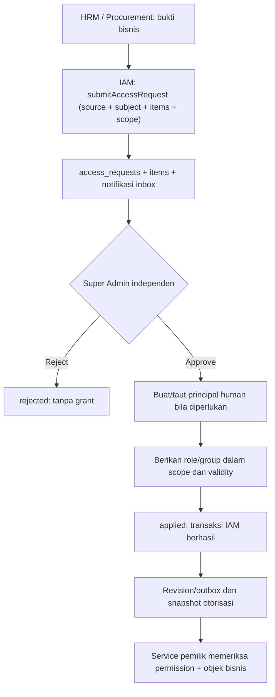

# Konsep Principal, Authentication, dan Authorization ERP

**Status:** pedoman konseptual lintas management, 12 November 2026. Dokumen ini menjelaskan model yang disepakati owner dan batas implementasi saat ini; contoh JSON, role, dan permission bisnis bukan seed atau grant baru. Baca bersama [AGENTS.md](../AGENTS.md), [boundary management](boundary.md), [DBML IAM](../backend/services/iam_management/db/schema/iam_management.dbml), dan [alur permintaan akses](../docs/03-managements/iam.md).

## 1. Istilah, identitas, dan kepemilikan

**Principal** adalah subjek yang dikenali IAM untuk autentikasi dan otorisasi. Satu sumber kebenarannya adalah tabel `principals` di database `iam`. `principal_kind=human` berlaku untuk orang (staf, admin, wakil supplier, pelanggan webcommerce); `principal_kind=workload` berlaku untuk layanan/mesin. GraphQL/protobuf dapat menyebut principal manusia sebagai `User`, tetapi itu **bukan** tabel `users` kedua.

- **Satu orang tidak harus dibuat sebagai principal baru hanya karena memakai portal berbeda.** Orang yang sama dapat menjadi pekerja HRM, perwakilan supplier, dan pelanggan Commerce. Seluruh hubungan bisnis itu **tidak otomatis menambah permission**. Penggabungan akun hanya setelah kepemilikan identitas dibuktikan, tidak dengan mencocokkan nama atau email yang belum diverifikasi.
- **`principal_id` adalah ID IAM, bukan `worker_id` HRM, `party_id` Foundation, atau `customer_account_id` Commerce.** Management menyimpan referensi logis yang diakui kontrak, bukan FK/SQL lintas database. HRM memakai `hr_workers.iam_principal_reference_id` jika sudah ditautkan.
- **IAM** menulis principal, identifier, kredensial, sesi, provider identity, role, permission, group, grant, override, approval permintaan akses, dan audit keamanan.
- **Enterprise Foundation** menulis master party, person/rekanan, badan hukum, unit organisasi, dan lokasi. **HRM** menulis pekerja, penempatan, dan hubungan kerja. **Procurement** menulis status kualifikasi supplier/proposal. **Commerce** menulis akun pelanggan per kanal, keranjang, checkout, quote, pengajuan pesanan dan proyeksi hasil yang ditampilkan ke pembeli. **Order Management (OMS)** adalah pemilik sales order, keputusan penerimaan/penolakan, pembatalan dan kasus retur. **Finance** memiliki AR invoice/receipt/credit note, sementara **WMS** memiliki stok/reservasi/fulfillment. Sumber fakta dan hak koreksi tetap milik masing-masing; mengetahui `commerce_order_submission_id` bukan hak untuk membaca order orang lain.
- **Realm** adalah batas keamanan/deployment IAM yang berbeda dari legal entity. `scope_type=legal_entity` atau `party` bukan nama realm; suatu realm dapat mengandung banyak legal entity/party.

## 2. Struktur `principals` dan `attributes JSONB`

Kolom utama `principals` saat ini mencakup `id`, `principal_kind`, `status`, `display_name`, nama, `locale`, `timezone`, `attributes jsonb NOT NULL DEFAULT '{}'`, `auth_version`, `opaque_session_epoch`, dan timestamp lifecycle. Identifiers berada di `principal_identifiers`; password di `account_credentials.secret_hash`; federasi di `federated_identities`. Jangan menambah `roles`/`permissions` sebagai array JSON di principal.

`principals.attributes` **sudah tersedia**, tidak perlu tabel atribut baru untuk use case ini. Gunakan hanya untuk metadata non-rahasia, bervolume kecil, bertipe dan di-allowlist oleh IAM. **Implementasi CreateUser/UpdateUser sekarang menegakkan metadata schema v1** melalui `backend/services/iam_management/internal/service/user/attributes.go`: objek kosong `{}` atau objek yang memuat `schema_version: 1`, opsional `onboarding_origin`, `ui_preferences.initial_workspace`, serta `context_display_hints` (maksimal delapan label unik), dengan batas ukuran JSON 4096 byte dan label huruf kecil/angka/underscore. Unknown key, tipe salah, secret, role, permission, group, dan klaim scope/PII mentah ditolak sebelum persistence. Contoh format yang diterima kode:

```json
{
  "schema_version": 1,
  "onboarding_origin": "human_resource_management",
  "ui_preferences": {
    "initial_workspace": "erp_internal"
  },
  "context_display_hints": ["staff", "webcommerce_customer"]
}
```

`onboarding_origin` menjelaskan asal registrasi awal, bukan management yang menguasai orang tersebut selamanya. `context_display_hints`/`ui_preferences` hanya untuk pengalaman pengguna. Label `staff`, `vendor`, `admin`, `customer`, `department`, atau UUID party dalam JSON **tidak boleh dianggap bukti authorization**. Jangan menjadikan `attributes` sumber kebenaran hubungan kerja, keanggotaan supplier, scope permission, saldo bisnis, status kualifikasi, atau kepemilikan pesanan.

**Aturan kualitas atribut:** hanya tulis melalui service IAM berotorisasi; validasi jenis/nilai/ukuran; bedakan atribut terverifikasi dan klaim mentah; catat sumber dan versi ketika memproyeksikan fakta; perbarui/hapus saat sumber berubah; hindari NIK/NPWP, password, access token, TOTP secret, bukti identitas, dan PII berisiko tinggi. Nilai JSON yang bisa diedit sendiri oleh pengguna tidak boleh langsung menghasilkan ALLOW. Bila provenance atau kesegaran atribut tidak dapat dibuktikan, ABAC harus menolak, bukan menganggap nilai default benar.

## 3. Authentication: siapa yang sedang bertindak?

**Authentication (AuthN) membuktikan identitas; tidak memberi hak bisnis.** Jalur manusia: identifier `principal_identifiers` (username/email terverifikasi sesuai kebijakan) → bukti password Argon2id atau provider terverifikasi → MFA bila diwajibkan → periksa status principal/kredensial → buat sesi IAM yang terikat pada principal dan realm. Aktivitas login, verifikasi dan pencabutan dicatat dalam IAM.

- **Staf internal:** IAM mengautentikasi orang. HRM hanya mengajukan onboarding/penempatan, tidak dapat menerbitkan sesi atau role dengan menulis field HRM.
- **Wakil vendor:** yang login adalah **orangnya**, bukan baris `parties`. `party_id` menentukan perusahaan yang mungkin diwakili, tetapi mandatnya harus berasal dari grant IAM yang aktif dan scope bisnis yang telah divalidasi.
- **Pelanggan Commerce:** login OAuth sosial/enterprise sebaiknya memakai **OpenID Connect (OIDC) untuk identitas** di atas OAuth 2.0. IAM harus memvalidasi issuer, signature, audience, expiry, state, nonce dan PKCE sesuai flow, lalu mengikat pasangan `provider_id + provider_subject` ke satu principal. Email saja bukan bukti aman untuk menggabungkan akun. Sesi pelanggan tidak memberikan role staf/supplier otomatis.
- **Workload/API:** principal `workload` menggunakan identitas dan kredensial layanan yang diverifikasi (misalnya mTLS atau API key melalui kontrak ingress tersendiri). Jangan memakai cookie browser atau menyamar sebagai principal manusia berdasarkan request payload.

**Status implementasi:** verifikasi password, MFA, login JWT lama dan gRPC sesi opaque/CSRF IAM memiliki implementasi serta tes. Gateway HTTP masih memerlukan cutover ke sesi opaque/validator CSRF sesuai keputusan leader; login OIDC pelanggan penuh sampai callback dan penerbitan sesi belum terbukti. Jangan mengklaim OAuth login siap hanya karena tabel `identity_providers`, `federated_identities`, dan `oauth_clients` tersedia. [Status autentikasi](../docs/02-architecture/security-and-sessions.md).

Untuk browser target: handle sesi opaque acak ditulis Gateway sebagai cookie aman `__Host-integrione_session` (Secure, HttpOnly, host-only, Path=/); token CSRF **satu token terpisah dari cookie** dikirim via header `X-CSRF-TOKEN`, diterbitkan/ditentukan validitasnya oleh IAM. Idle 30 menit dan absolut 8 jam. Token tidak boleh masuk URL/log; lokasi validasi CSRF di proses IAM vs validator IAM reusable harus dikunci sebelum cutover. Jangan aktifkan fallback ke login lama saat validasi sesi baru gagal.

## 4. Authorization: apa yang boleh dilakukan, pada objek milik siapa?

**Authorization (AuthZ) adalah RBAC + ABAC, bukan `principals.attributes` saja.** Tabel sumber di IAM:

| Kebutuhan | Tabel/kolom otoritatif |
|---|---|
| Role master | `roles` (kode unik global, `role_domain`, status) |
| Permission master | `permissions` (`resource`, `action`, `risk_level`, `is_sensitive`) |
| Permission dalam role | `role_permissions`, opsional `role_inheritance` |
| Role langsung principal | `principal_role_assignments` dengan `scope_type`, `scope_id`, validity, revocation |
| Group/security membership | `groups`, `group_memberships`, `group_role_assignments` |
| ALLOW/DENY langsung sebagai pengecualian | `principal_permission_overrides` (peminta/penyetuju, alasan, expiry) |
| Delegasi dan aktivasi sesi | `delegated_access_grants`, `session_role_activations` |
| Kondisi ABAC | `authorization_policies.condition_expression` dan evaluator bertipe |
| Perubahan hak dan proyeksi | `iam_authorization_revision`, outbox, snapshot akses berversi |

**Jangan** menyimpan atau menghitung hak dengan membaca string `role`/`permission`/`group` dari `principals.attributes`. `superadmin` adalah administrasi IAM, bukan wildcard bisnis lintas management. Lima template IAM saat ini: `superadmin`, `iam_readonly`, `iam_operator`, `iam_selfservice`, `iam_access_requester`; role bisnis seperti `finance_accounting_staff` dan `procurement_sourcing_vendor_representative` adalah **kandidat sampai developer pemilik menyetujui katalog dan admin memasangnya**. [Katalog](roles-permissions/iam_management/2-permintaan-akses-dan-katalog-role.md).

**Scope:** `global` wajib tanpa `scope_id`; scope khusus (`party`, `legal_entity`, `organization_unit`, `location`, `self`, `provisioning_source`, dll.) wajib UUID objek/sumber yang sesuai kontrak. `global` bukan default aman untuk vendor atau staf. IAM menyimpan scope grant; service pemilik objek membuktikan relasi resource dengan scope pada setiap operasi termasuk list/search/export.

Sebuah pemeriksaan akses memakai empat komponen:

1. **Subject:** principal aktif, realm, session/generation, role/group/grant yang efektif, expiry, dan assurance autentikasi dari IAM.
2. **Action:** permission spesifik dari katalog pemilik domain, misalnya kandidat `procurement_sourcing.supplier_proposal.submit`, bukan sekadar nama role.
3. **Resource:** atribut objek bisnis **hasil baca tepercaya dari service pemilik**, misalnya `supplier_party_id` proposal dari Procurement atau `customer_account_id`/referensi principal pada **submission Commerce milik pembeli** yang diverifikasi ke sesi dan channel; status sales order tetap keputusan OMS.
4. **Environment:** waktu server, level MFA yang masih berlaku, context/realm, serta keadaan dependency yang diperiksa. Nilai dari header/input klien tidak otomatis dipercaya.

**Urutan keputusan:** autentikasi valid → snapshot otorisasi untuk principal/session/realm/management yang benar dan masih segar → permission yang relevan → effect dan scope → kondisi ABAC atas atribut aktual → aturan bisnis dan SoD → ALLOW hanya jika semuanya lolos. DENY eksplisit mengalahkan ALLOW. Tidak ada grant, scope salah, attribute wajib hilang, kondisi tidak didukung, expiry, atau revoke efektif berarti **tidak boleh ALLOW**. Snapshot di Redis hanyalah proyeksi/receipt; PostgreSQL IAM tetap sumber hak. Freshness snapshot paling lama 30 detik sejak verifikasi otoritatif, bukan izin menunda revoke yang sudah efektif.

**HTTP/gRPC:** tanpa autentikasi yang valid → 401 / `Unauthenticated`; terautentikasi tetapi tidak berhak → 403 / `PermissionDenied`; tidak dapat memvalidasi karena dependency gagal atau snapshot kedaluwarsa → 503 / `Unavailable` (fail-closed). Jangan mengembalikan 401 semata-mata karena role tidak ada. Transaksi sensitif (approval/posting/grant) membutuhkan recheck dekat titik commit; request ditolak tidak boleh mengubah DB/outbox bisnis.

## 5. Permintaan principal dan akses oleh management

Statusnya berbeda antara **permintaan**, **notifikasi dibaca**, **disetujui**, **assignment tersimpan**, dan **akses efektif dipakai konsumen**.



- **HRM:** pekerja Finance Staff disetujui HRM dan penempatan disimpan di HRM; pengajuan IAM memakai `source_management=human_resource_management`, `kind=employee`, `source_reference` (bukti keputusan), `source_subject_reference` (ID pekerja stabil), role Finance yang **sudah disetujui developer Finance**, dan scope unit/legal entity resmi. Disetujui Super Admin tidak otomatis menutup alur verifikasi identifier, undangan atau aktivasi akun.
- **Procurement:** setelah kualifikasi disetujui dan Foundation menyediakan master party, pengajuan memakai `source_management=procurement_sourcing`, `kind=vendor`, `source_reference` (bukti keputusan), `source_subject_reference` (ID wakil orang, **bukan** ID dokumen/perusahaan), dan `scope_type=party` dengan `scope_id` UUID party Foundation. Dua PIC dengan dokumen sama adalah dua subject berbeda.
- **IAM:** `provisioning_sources` mengidentifikasi management pengaju; role `iam_access_requester` berscope `provisioning_source` memungkinkan pengajuan sumber tersebut, **bukan persetujuan**. Inbox tersimpan dalam `access_request_notifications` dengan receipt per admin di `access_request_notification_reads`. Keputusan dan item di `access_requests` / `access_request_items`; identitas sumber-orang di `access_request_subjects`. Request idempotent dan Super Admin terpisah dari peminta/penerima. `applied` artinya grant tersimpan, belum otomatis membuktikan semua management telah meng-enforce grant tersebut.
- **Katalog role/group/permission bisnis:** developer setiap management menentukan arti, daftar operasi aktual, risk, scope, matrix `role_permissions`, SoD, dan tes. Tuliskan di `agents/roles-permissions/{management}/{id}-roles-permissions.md` dan keputusan/handoff di `agents/notes/iam_management/{id}-{management}.md`. IAM memvalidasi duplikasi, hak pengelola, request, dan persistence; **tidak** mengarang hak bisnis atau memberikan role otomatis dari jabatan HRM ataupun label party Foundation.

[Lihat operasi inbox dan kontrak](../docs/03-managements/iam.md).

## 6. Contoh tiga konteks pada satu orang

| Konteks | Referensi bisnis pemilik | Grant IAM yang mungkin | Aturan pemilik yang wajib dicek |
|---|---|---|---|
| Staf Finance | `worker_id` HRM dan `organization_unit_id` EF | role Finance dengan scope disetujui | Finance memeriksa unit pemilik invoice, status transaksi dan pemisahan tugas |
| Wakil Supplier A | `party_id` Foundation + person/PIC dan approval Procurement | role vendor berscope `party=A` | Procurement membaca supplier dari proposal tersimpan dan menolak B |
| Pelanggan webcommerce | `commerce_customer_account_id` Commerce ditaut ke principal | izin akun/self Commerce yang disepakati | Commerce memeriksa kepemilikan akun, cart, checkout dan submission per kanal; OMS pemilik sales order, Commerce hanya membaca proyeksi status berizin |

Perubahan hubungan kerja atau pencabutan mandat supplier harus memicu permintaan pencabutan/rekonsiliasi ke IAM. Menonaktifkan akses staf **tidak otomatis** menghapus identitas pelanggan yang masih sah; tetapi penonaktifan principal global dan revokasi seluruh sesi tetap berdampak sesuai kebijakan IAM. Penggunaan beberapa konteks harus selalu meminta scope yang eksplisit, tidak menggabungkan izin supplier, Finance dan pelanggan menjadi wildcard.

## 7. Checklist developer management sebelum mengklaim integrasi selesai

1. Kunci pemilik objek dan referensi logis; jangan menulis langsung ke tabel IAM atau menduplikasi `principals`.
2. Tentukan permission per operasi Query/Mutation/RPC yang **benar-benar tersedia**, katalog role/group, scope UUID, SoD, dan siapa yang berwenang memberi/mencabut. Dokumentasikan status *usulan* vs *aktif*.
3. Gunakan alur request → inbox → keputusan independen untuk provisioning, bukan menganggap event HRM/Procurement sebagai grant otomatis.
4. Ambil principal dari konteks autentikasi tepercaya, bukan `principal_id` buatan frontend; ambil atribut resource untuk ABAC dari database/service pemilik objek, bukan ID klien.
5. Terapkan guard pada service bisnis dan list/filter/export (bukan hanya UI/Gateway). Tolak tanpa grant, mismatch scope, DENY, stale/unsupported policy dan dependency unavailable; pastikan denial tidak menulis state.
6. Siapkan dua pengguna E2E *sebelum tes*: satu berizin dan satu valid tetapi tanpa permission target. Tes tidak membuat grant dinamis. Jalankan HTTP GraphQL → gRPC → service → PostgreSQL `*_test`, termasuk revoke/expiry, beberapa group dan lintas party.
7. Bedakan status **IAM terimplementasi**, **browser cutover terintegrasi**, **OAuth customer terverifikasi**, serta **enforcement objek bisnis E2E**. Tidak satu pun dibuktikan hanya dengan kehadiran DBML atau status `applied`.

## 8. Matriks akses pelanggan website versus pegawai dan service

Aktor yang memakai situs perusahaan memiliki batas kepercayaan berbeda. **Pengunjung anonim** hanya boleh menggunakan operasi etalase yang secara eksplisit publik, dengan kanal dan publikasi yang telah divalidasi. **Tamu** boleh membuat/mengakses cart atau checkout miliknya setelah bukti akses sesi tamu dibuktikan; ID GraphQL yang diketahui orang lain **bukan** token akses. **Pembeli login** memakai principal IAM dan aturan kepemilikan per kanal. **Staf** memerlukan permission, scope legal entity dan atribut objek selain autentikasi. **Worker internal** memerlukan workload identity serta audience/delegasi, bukan cookie pelanggan.

| Pelaku | Autentikasi | Pembatasan otorisasi |
|---|---|---|
| Pengunjung publik | Tidak membutuhkan principal untuk query publik yang sudah dinyatakan aman | Situs/kanal tepercaya, listing LIVE, field/locale sesuai publikasi; tidak boleh membaca draft atau objek pelanggan. |
| Pembeli tamu | Handle sesi tamu acak, cookie aman, CSRF/origin untuk mutasi | Pemilik cart/checkout serta channel, expiry, replay/idempotensi; tidak boleh mengklaim cart milik orang lain. |
| Pembeli login | Sesi IAM terverifikasi; jika OIDC, hasil binding identitas harus valid | Principal terikat account/submission dan scope kanal; akses self tidak memberi akses staff atau seluruh OMS. |
| Staf toko | Sesi IAM aktif dan grant commerce yang disetujui | Scope penjual/legal entity, izin pengelolaan listing, publikasi, data pelanggan dan aksi sensitif secara terpisah. |
| Layanan/worker | Principal `workload`, kredensial service dan audience terverifikasi | Aksi internal yang spesifik dan dicatat; tidak mengambil user principal dari input/event tanpa delegasi sah. |

Jangan menyemai role/permission Commerce spekulatif untuk mengaktifkan seluruh GraphQL. Katalog sumber kebenaran tetap ditetapkan bersama IAM dan developer Commerce. Validasi `node(id:)`, nested field, list/count/search/export dan cursor harus mencakup pemeriksaan kanal, realm, scope, kepemilikan dan sensitivitas yang sama dengan query induknya. **Hak IAM yang efektif tidak menghapus invariant bisnis**: pembeli boleh melihat submission miliknya tetapi tidak memutuskan apakah OMS menerima order atau apakah Finance menerima pembayaran.

Pemisahan dan contoh implementasi: [arsitektur induk](arsitektur.md), [batas management](boundary.md), [kontrak toko web](../backend/gateway/graph/schema/ecommerce_commerce.graphqls), [readiness Commerce](../backend/services/ecommerce_commerce/README.md).

## Referensi source

- [Model IAM PostgreSQL](../backend/services/iam_management/db/schema/iam_management.dbml)
- [Katalog template role IAM](../backend/services/iam_management/internal/authorization/templates.go)
- [Access request dan notifikasi](../docs/03-managements/iam.md)
- [Authentication](../docs/02-architecture/security-and-sessions.md)
- [Snapshot dan kebijakan ABAC](../docs/02-architecture/security-and-sessions.md)
- [Boundary ownership](boundary.md)
