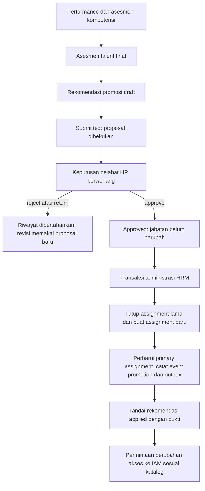

# Talent Management di dalam HRM

**Keputusan owner 16 November 2026:** Talent Management disatukan dengan Human Resource Management. Recruitment/Talent Acquisition tetap menjadi domain HRM. Keputusan ini tidak membuat management, database, worker master atau microservice Talent terpisah. Domain internal tetap dibedakan agar aturan dan hak akses tiap proses jelas.

Status: rancangan DBML dan baseline SQL teruji; service bisnis, API, IAM policy dan E2E belum diimplementasikan. [Skema utama](../db/schema/human_resource_management.dbml) · [Peta fungsi HRM](schema-design.md).

## Kepemilikan dan batas proses

| Fakta | Pemilik proses di dalam HRM |
|---|---|
| Kandidat eksternal, lamaran, interview, offer dan hiring | Recruitment/ATS |
| Worker, kontrak, status kerja, penempatan dan promosi resmi | Administrasi hubungan kerja |
| Skill/kompetensi, bukti asesmen dan persyaratan jabatan | Kompetensi |
| KPI, pengukuran, review dan hasil kinerja | Performance |
| Potensi, readiness, kalibrasi dan talent pool internal | Talent assessment |
| Aspirasi, jalur karier, development plan dan suksesi | Career & succession |
| Kursus, outcome kompetensi, enrollment dan sertifikasi | Learning & development |
| Pengusulan dan persetujuan promosi | Talent recommendation + persetujuan HR yang berwenang |

Semua memakai `hr_workers.id`. Kandidat belum menjadi worker tetap di `hr_candidates`/`hr_applications`; status ATS `talent_pool` tidak sama dengan pool talenta karyawan. Skill teknis, perilaku dan leadership menggunakan katalog kompetensi yang sama dengan kategori dan rubrik berversi, sehingga tidak diperlukan master skill kedua.

Unit organisasi, badan hukum, party dan lokasi tetap Foundation. Job/position dan assignment resmi tetap HRM. IAM memiliki identitas/grant; Finance memiliki jurnal dan verifikasi pembayaran; DRM memiliki dokumen berversi. Contoh organisasi/attendance pada penjelasan konseptual tidak memindahkan ownership Foundation atau roster/absensi operasional dari boundary proyek.

## Tambahan skema: 17 tabel

| Kemampuan | Tabel baru | Tujuan |
|---|---|---|
| Rubrik penilaian talenta | `hr_talent_frameworks`, `hr_talent_dimensions` | Versi rubrik, dimensi, bobot dan bukti arti level 1–5. |
| Siklus dan asesmen | `hr_talent_review_cycles`, `hr_talent_assessments`, `hr_talent_assessment_scores` | Penilaian potensi/readiness terpisah dari performance dan kompetensi; terikat worker, cycle dan framework. |
| Kalibrasi | `hr_talent_calibration_sessions`, `hr_talent_calibration_decisions` | Panel mencatat skor awal, skor hasil dan alasan tanpa menimpa asesmen awal. |
| Talent pool internal | `hr_talent_pools`, `hr_talent_pool_memberships` | Kriteria pool, nominasi, approval, masa berlaku dan alasan keluar. |
| Karier | `hr_career_paths`, `hr_career_path_transitions`, `hr_worker_career_aspirations` | Jalur promosi/lateral/spesialisasi dan aspirasi yang dinyatakan pekerja. |
| Promosi | `hr_promotion_recommendations`, `hr_promotion_decisions` | Proposal, riwayat keputusan dan bukti penerapan resmi. |
| Outcome pelatihan | `hr_learning_course_competencies` | Satu kursus mengembangkan beberapa kompetensi pada target level berbeda. |
| KPI dan review | `hr_performance_goal_updates`, `hr_performance_review_goal_scores` | Riwayat pengukuran serta penilaian goal pada review pekerja dan siklus yang benar. |

`hr_succession_candidates.talent_assessment_id` menghubungkan kandidat suksesi dengan bukti talenta milik pekerja yang sama. Development plan/action yang sudah tersedia tetap dipakai untuk pelatihan, coaching, mentoring, penugasan dan belajar mandiri.

Nine-box tidak dibuat sebagai nilai universal yang menentukan nasib karyawan. Jika dipakai, definisi band performance/potential dan pemetaan segmen ada pada rubrik berversi; `segment_code` menyimpan hasil interpretasinya. Skor 1–5 pada versi rubrik berbeda tidak otomatis sebanding.

Skill gap diperoleh dari persyaratan `hr_job_competencies` untuk job tujuan dibanding asesmen pekerja yang masih berlaku. Perhitungan memerlukan bukti dan versi yang tepat; gap tidak disimpan sebagai master baru yang bisa tertinggal dari sumber. Selesai kursus tidak otomatis membuktikan kompetensi tanpa asesmen.

## Alur promosi resmi

State machine: `draft → submitted → approved → applied`. Dari submitted boleh rejected/returned/cancelled; draft boleh cancelled. `defer` mencatat keputusan menunggu tanpa mengubah submitted. Keputusan approval wajib keputusan terbaru dari rekomendasi yang sama. Perubahan proposal setelah submitted membuat rekomendasi baru dengan `supersedes_recommendation_id`; keputusan lama tetap utuh. Pembatalan setelah approved/applied memerlukan proses koreksi hubungan kerja yang dirancang terpisah, bukan mengembalikan status ke draft.

**Contoh Andi:** data jabatan Store Supervisor tetap di assignment. Leadership level 4 memakai asesmen kompetensi; hasil dua semester tetap dua performance review; potensi memakai talent assessment. Aspirasi Store Manager, nominasi pool, rencana kursus Financial Management dan kandidat suksesi tidak mengubah jabatan. Approval promosi juga belum mengubahnya. Baru transaksi administrasi HRM yang menerapkan keputusan membuat penempatan Store Manager dan event `promotion`.

Promosi dengan tanggal efektif mendatang tetap approved sampai tanggal tersebut; penjadwal/service memvalidasi tanggal bisnis sebelum menerapkan perubahan. Implementasi service harus menerapkan perubahan assignment, primary pointer, event, outbox dan status applied dalam satu transaksi. SQL guard memverifikasi bukti saat applied, **tidak melakukan mutasi assignment otomatis**. Identitas IAM tidak otomatis mendapat hak baru setelah job berubah.

## Integritas yang ditegakkan baseline

- FK gabungan menolak penggunaan assessment/review/development plan milik pekerja lain, dimensi framework lain, kalibrasi siklus lain, target karier salah serta goal review milik pekerja/siklus berbeda.
- Framework yang disahkan immutable. Dimensi dibekukan sejak dipakai suatu cycle; perubahan rubrik membuat framework versi baru.
- Finalisasi assessment memerlukan seluruh skor dimensi wajib. Assessment final dan skor turunannya immutable; perubahan menggunakan versi assessment baru.
- Kalibrasi mempertahankan original_score yang cocok dengan skor sumber dan menyimpan keputusan append-only. Riwayat KPI dan keputusan promosi juga append-only.
- Keanggotaan pool active/exited tidak boleh bertumpuk dalam pool/pekerja sama. Pool aktif memerlukan approval; exited memerlukan akhir periode dan alasan.
- Rekomendasi dimulai draft dan wajib memakai asesmen final ketika submitted. Pengusul tidak dapat menjadi pelaku keputusan; nomor tahap keputusan meningkat. Proposal submitted dan keputusan final tidak dapat ditimpa.
- Approved memerlukan keputusan approve terbaru. Applied memerlukan assignment baru pada target position dan worker yang sama, tanggal efektif sesuai keputusan, primary pointer sudah berpindah, assignment lama ditutup sehari sebelumnya, serta event promotion dengan worker/tanggal/source rekomendasi yang cocok.

## Aturan yang masih harus diterapkan service

1. Actor autentik, izin per operasi dan sensitivitas, scope legal entity/unit, pihak yang boleh membuka potensi/9-box, mandat panel, independensi penyetuju terhadap worker yang dipromosikan, seluruh tahap approval dan recheck IAM sebelum commit. CHECK actor berbeda dari pengusul belum membuktikan hak persetujuan.
2. Worker memenuhi status hubungan kerja yang sah; sumber assignment masih current saat permohonan; target posisi aktif dan kapasitas/budget tersedia; employer, kontrak, kompensasi serta tanggal efektif konsisten. Jalur promosi ini untuk primary assignment; perubahan secondary atau koreksi retroaktif membutuhkan alur tersendiri.
3. Setelah applied, perubahan berikutnya pada assignment/lifecycle harus mengikuti transaksi koreksi yang menjaga riwayat. Guard applied memeriksa fakta saat transisi, bukan jaminan semua field pada tabel employment selamanya immutable.
4. Rubrik lengkap, total bobot, sumber performance final, periode/validitas bukti dan framework, eligibility pool, status cycle/session dan mandat pengambil keputusan. Kalibrasi harus atas assessment final dalam sesi terbuka. Jumlah skor tidak otomatis menetapkan promosi atau keputusan kerja.
5. Projection `hr_performance_goals.actual_value` konsisten dengan riwayat; rincian review dibekukan saat review final; mapping gap kompetensi tidak menyamakan rubrik berbeda; retensi, akses dan koreksi/keberatan karyawan sesuai kebijakan yang disahkan.
6. Transaksi promotion + outbox idempotent, event ordering, concurrency/retry dan receipt IAM. Test SQL tidak menggantikan service tests dan E2E autentikasi/otorisasi.

## Validasi aktual

Baseline `000001` diregenerasi dengan DBML CLI 12.0.0. Total skema sekarang **86 tabel**, **130 FK internal**, **150 CHECK**, 9 enum dan 12 TableGroup. Tambahan PostgreSQL total lima exclusion constraint, 14 trigger dan delapan function.

`bash backend/services/human_resource/db/test/verify_schema.sh` menjalankan 38 kasus lama + **32 kasus negatif Talent baru**, semuanya lulus pada PostgreSQL Docker. Fixture positif membuktikan asesmen/approval tidak mengubah assignment, penerapan promosi dengan bukti lengkap berhasil, skor sebelum/sesudah kalibrasi terpisah dan satu kursus dapat memetakan banyak kompetensi. Siklus up → tes → down → up lulus; database disposable dihapus. Tidak ada database aplikasi dimigrasikan atau service baru dideploy.

## Pemetaan dengan skill Database Engineer

`usp: cognitive_schema_mapper`, `source: analysis`. Ontologi: worker HRM → performance/kompetensi → asesmen talent → kalibrasi/pool/karier/suksesi → rekomendasi → keputusan → penempatan resmi. Semantic gaps yang ditutup: rubric/assessment, calibration, internal pool, career path/aspiration, promotion decision/application, course multi-competency dan riwayat KPI. Rekomendasi mengikuti keputusan owner menggabungkan domain dalam HRM, memakai bukti source/DBML serta tes PostgreSQL. Confidence tinggi pada constraint yang diuji; belum dinilai untuk workflow nyata perusahaan, keamanan runtime, concurrency, skala data atau kepatuhan hukum.
