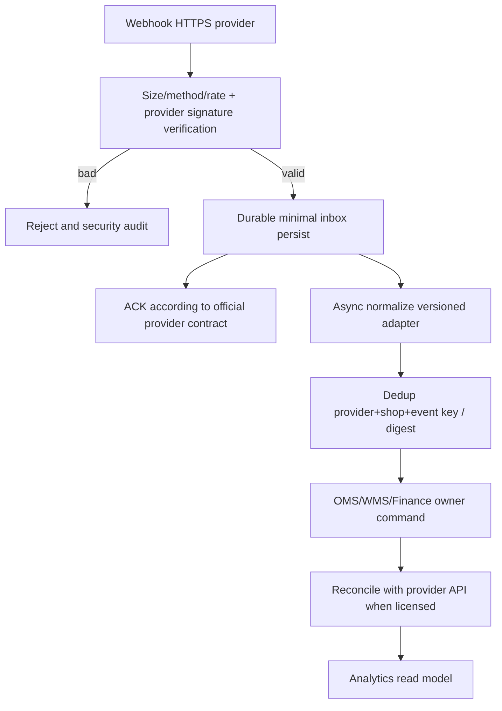

# Integrasi Shopee/TikTok Shop, Webhook dan Sinkronisasi

> **Baseline 12 November 2026.** Kebijakan keamanan/izin harus cocok dengan [agents/arsitektur.md](../../agents/arsitektur.md); ownership ditentukan oleh [boundary management](../../agents/boundary.md). Status runtime perlu dibuktikan dari kode/tes terbaru.

## Status sumber eksternal
**Belum diverifikasi di percakapan ini:** API endpoint/permissions resmi Shopee/TikTok Shop, skema signature dan header, OAuth/token format, quota, ketersediaan analytics per-SKU, retention dan callback final. Semua adalah **DEPENDENCY PROVIDER**, bukan spesifikasi terimplementasi. Developer hanya boleh mengunci kontrak setelah membaca dokumen resmi dan memperoleh izin partner/test shop yang sah.

## Inbound event

Validasi signature memakai **algoritma dan secret resmi provider**, bukan klaim generik HMAC sebagai implementasi setiap kanal. ACK setelah durable persist sesuai aturan provider. Webhook dapat hilang/duplikat/out-of-order; “realtime” adalah **target lag terukur**, bukan exactly-once delivery.

## Identity & ownership
Account provider/shop milik instalasi pelanggan yang memiliki grant; token disimpan terenkripsi via secret vault, dipisah per channel/account, dapat dicabut/diputar. External SKU↔PLM item, listing↔Commerce, order ID↔OMS, inventory↔WMS, settlement↔Finance; jangan menyimpan master alternatif di adapter.

## Outbound synchronization
Produk/listing, harga dan available-to-sell disalin sebagai **proyeksi** yang memiliki source revision, timestamp/freshness dan status `PENDING|SYNCED|RETRY|FAILED|CONFLICT`. Provider ACK transport tidak membuktikan listing langsung tayang. Gunakan outbox, rate limit, backoff dan reconciliation checkpoint. Jika provider tidak menyediakan API yang dibutuhkan, tampilkan `UNAVAILABLE`, bukan data fiktif.

## Test gate
Official provider test fixture/signature, invalid/replay, token expired, cross-account, event 100× duplicate, out-of-order, quota, callback timeout, worker restart, reconciler, concurrent WMS holds, OMS one-order, Finance no auto-paid. Tes mock hanya service test, bukan verifikasi kanal production.
