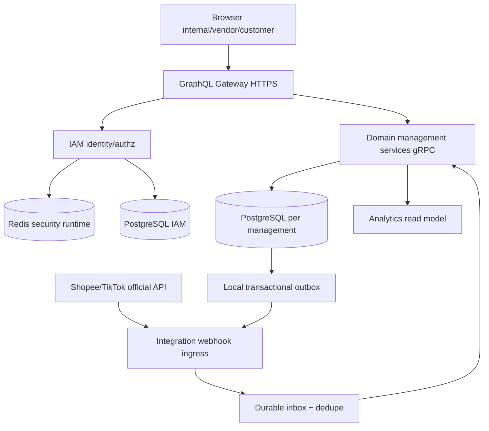

# System Architecture Document (SAD)

> **Baseline 12 November 2026.** Kebijakan keamanan/izin harus cocok dengan [agents/arsitektur.md](../../agents/arsitektur.md); ownership ditentukan oleh [boundary management](../../agents/boundary.md). Status runtime perlu dibuktikan dari kode/tes terbaru.

## Lingkup
Integrione adalah Go modular/microservices ERP untuk usaha penjual produk jadi: internal operasional, vendor/supplier, integrasi marketplace dan analitik, lalu storefront pembeli. Setiap management memegang fakta dan transaksi dalam database PostgreSQL logis sendiri; gateway menghadap browser, gRPC privat antar-service.

## Single HTTP API ingress — keputusan owner 13 November 2026

Aplikasi hanya mempublikasikan endpoint HTTP API **`/api/graphql`**.
Autentikasi, sesi, CSRF, dan aksi bisnis masuk sebagai operasi GraphQL,
bukan endpoint REST. Caddy menolak path `/api/*` lainnya. HTTP halaman/static
Next.js bukan API. Pemeriksaan liveness melalui Query GraphQL `{ health }`
dan tidak menambah route `/healthz`. gRPC antar-management tetap privat.

Diagram marketplace menggambarkan kebutuhan integrasi masa depan, **bukan
izin membuat endpoint webhook publik tambahan**. Kontrak provider yang
mewajibkan callback khusus memerlukan keputusan owner terpisah sebelum ingress
diterbitkan. Rujuk [keputusan owner](../00-governance/decisions.md).

## Pembagian tanggung jawab
- **Gateway:** HTTP/GraphQL, transport auth, cookie/CSRF, validasi site/host, API mapping, request IDs dan error. Ia bukan pemilik order, stok, harga atau invoice.
- **IAM:** human/workload principal, session, role, permission, scope, group, revocation, snapshot versioned/freshness.
- **Domain owners:** PLM katalog, Procurement PO, WMS stok, OMS sales order, Finance uang/jurnal, Pricing harga, Commerce listing/cart/quote/submission, CRM/Service/DRM/HRM/EF sesuai [ownership](service-boundaries.md).
- **Integration:** validasi provider credentials/signature, kanal dan account mapping, durable ingest, outward sync/reconcile. Webhook tidak langsung mengubah ledger bisnis.
- **Analytics:** membaca fakta berversi, dedupe, menghitung metrik; bukan owner OLTP.

## Sifat deployment
Per-company isolated install adalah baseline historis RaaS, namun menjual jasa kepada banyak UMKM tidak otomatis menandakan shared multitenancy. Pilihan shared model memerlukan ADR serta bukti isolation, cost dan data migration.

## Keamanan dan reliability
Traffic antar workload diautentikasi dan audience dibatasi; browser header principal/role tidak dipercaya. Opaque session target dengan idle 30 menit, absolut 8 jam, grant freshness ≤30 detik. Database beda tidak memakai transaksi SQL bersama; gunakan outbox/inbox serta idempotency dan reconciliation.

## Belum diwujudkan sebagai produk penuh
Web commerce A–H, Pricing/OMS lintas owner, customer OIDC/website, integrasi marketplace production, real-time SLA, finance settlement gateway dan deployment multi-customer belum dinyatakan lengkap. Jangan menampilkan kotak arsitektur sebagai bukti readiness.
